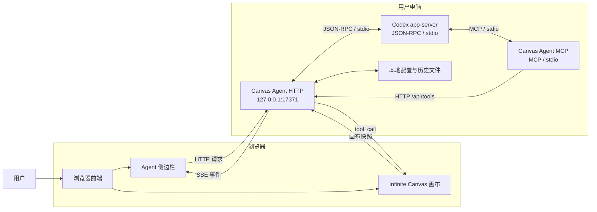
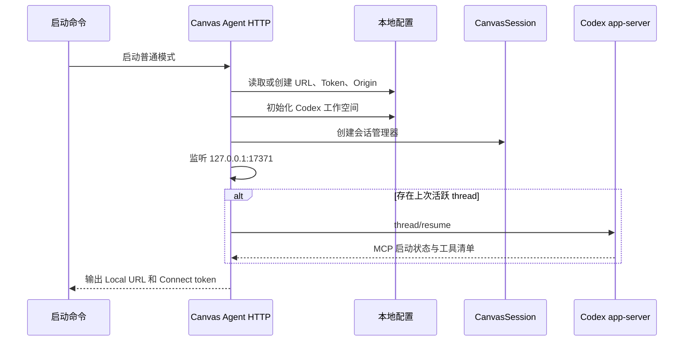
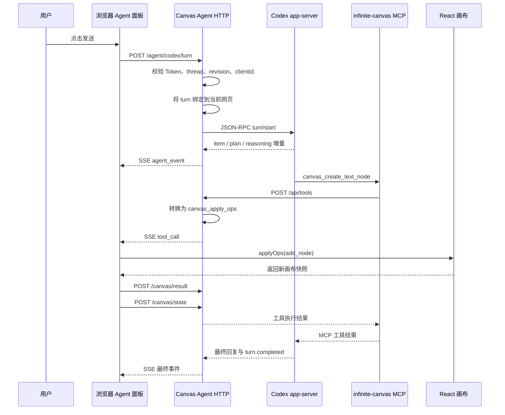
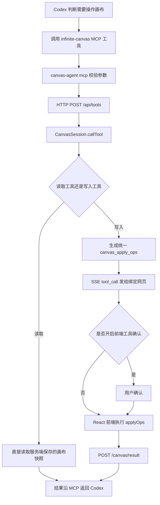

# Canvas Agent 完整链路详解

> 面向第一次接触 Agent、Codex、MCP、SSE 的读者。
>
> 本文依据当前仓库源码整理，重点解释：连接 Token 有什么用、Canvas Agent 怎样接入 Codex、MCP 怎样操作画布，以及浏览器前端如何参与整个过程。

## 1. 先用一句话理解

`canvas-agent` 是运行在用户电脑上的一个本地中转站：

- 浏览器把当前画布状态交给它。
- 它把用户任务交给本机 Codex。
- Codex 通过 MCP 请求读取或修改画布。
- 它再把修改请求发回浏览器。
- 浏览器真正执行操作，并把结果沿原路返回给 Codex。

最重要的一点是：

> Codex 不会直接修改 React 页面，MCP 进程也不保存真实画布。真正持有和修改画布状态的是浏览器前端。

## 2. 为什么不能让浏览器直接连接 Codex

浏览器有安全限制，普通网页不能随意：

- 启动电脑上的 `codex` 命令。
- 读写任意本地文件。
- 创建本地子进程。
- 直接使用命令行的标准输入输出。

Codex 也不知道浏览器中正在打开哪个画布、有哪些节点、选中了什么。

所以项目在两者之间放了一个本地 Node.js 程序：

```text
浏览器网页 <-> Canvas Agent <-> Codex
```

Canvas Agent 同时理解三套通信方式：

| 通信方式 | 连接双方 | 主要用途 |
| --- | --- | --- |
| HTTP | 浏览器 / MCP -> Canvas Agent | 提交任务、上报状态、返回工具结果 |
| SSE | Canvas Agent -> 浏览器 | 持续推送 Codex 消息和画布工具请求 |
| JSON-RPC over stdio | Canvas Agent <-> Codex app-server | 创建线程、发送任务、接收流式事件 |
| MCP over stdio | Codex <-> `canvas-agent mcp` | 让 Codex 看见并调用画布工具 |

## 3. 整体网络结构



图中看起来有两个 Canvas Agent，实际是同一个 npm 包的两种运行模式：

1. 普通模式启动 HTTP 服务。
2. `mcp` 模式启动 MCP stdio 服务。

它们读取同一个 `~/.infinite-canvas/canvas-agent.json`，因此 MCP 进程知道 HTTP 服务的地址和 Token。

## 4. 目录与职责

核心代码可以先按下面的方式记忆：

```text
canvas-agent/src/
├── index.ts                 程序入口，选择 HTTP 或 MCP 模式
├── config.ts                本地配置、Token、工作空间
├── server/
│   ├── http.ts              HTTP/SSE 总调度中心
│   └── mcp.ts               MCP 工具服务与 HTTP 转发
├── agent/
│   ├── codex.ts             Codex 上层业务封装
│   ├── codex-client.ts      Codex app-server JSON-RPC 客户端
│   ├── codex-protocol.ts    app-server 协议类型
│   ├── codex-history.ts     Codex 历史转前端消息
│   └── codex-event-history.ts
│                              补充保存实时过程事件
└── canvas/
    ├── session.ts           网页连接、画布快照、工具请求中枢
    ├── schemas.ts           MCP 工具名、说明和参数 Schema
    ├── operations.ts        高层工具转为统一画布操作
    └── tools.ts             参数校验、快照压缩等工具
```

前端主要对应：

```text
web/src/
├── components/agent/local-agent-panel.tsx
│                              连接、聊天、SSE 事件和工具执行
├── services/api/canvas-agent.ts
│                              Canvas Agent HTTP 请求封装
├── stores/use-agent-store.ts  Agent 全局状态
├── pages/canvas/hooks/use-agent-bridge.ts
│                              React 画布与 Agent 的桥
└── lib/canvas/canvas-agent-ops.ts
                               在前端计算节点和连线变更
```

## 5. 两种启动模式

入口在 `canvas-agent/src/index.ts`：

```ts
if (process.argv[2] === "mcp") await startMcpServer();
else startHttpServer();
```

### 5.1 普通 HTTP 模式

```bash
npx -y @basketikun/canvas-agent@latest
```

启动内容：

- 读取或创建本地配置。
- 监听 `127.0.0.1:17371`。
- 创建 `CanvasSession`。
- 初始化 Codex 工作空间。
- 输出 `Local URL` 和 `Connect token`。
- 必要时恢复上一次活跃的 Codex thread。

启动输出类似：

```text
Infinite Canvas Agent
Local URL: http://127.0.0.1:17371
Connect token: 012345...
```

这个进程是整个系统的中心，浏览器必须先连接它。

### 5.2 MCP 模式

```bash
npx -y @basketikun/canvas-agent@latest mcp
```

这个模式：

- 不创建新的 HTTP 端口。
- 使用 MCP SDK 注册画布工具。
- 通过标准输入输出与 Codex 通信。
- 收到工具调用后，请求现有 HTTP 服务的 `/api/tools`。

所以只启动 MCP 模式是不够的。它仍需要普通 HTTP 模式正在运行，并且需要有浏览器画布连接到 HTTP 服务。

## 6. 连接 Token 到底是什么

### 6.1 Token 如何生成

首次没有配置文件时，`config.ts` 使用：

```ts
crypto.randomBytes(18).toString("hex")
```

18 个随机字节转换为十六进制后，得到 36 个字符的随机 Token。

配置保存到：

```text
~/.infinite-canvas/canvas-agent.json
```

配置目录权限会被设置为 `0700`，文件权限会被设置为 `0600`。

需要注意：

> Token 不是每次启动都重新生成。只要配置文件还存在，后续启动会继续使用同一个 Token。

### 6.2 Token 起什么作用

Token 是访问本机 Canvas Agent HTTP 接口的连接口令。

除了 `/health` 和 `/config` 等少量发现接口，其他接口都必须提供正确 Token，例如：

```text
GET /events?token=...
POST /agent/codex/turn?token=...
```

也可以通过请求头传递：

```http
x-canvas-agent-token: ...
```

MCP 进程请求 `/api/tools` 时使用的就是这个请求头。

### 6.3 为什么监听本机还需要 Token

`127.0.0.1` 只能阻止其他电脑直接访问，但不能阻止用户浏览器里打开的其他网站尝试访问本机端口。

例如，一个恶意网页可能尝试：

```text
http://127.0.0.1:17371/api/tools
```

Token 用来证明：

> 这个请求来自拿到本次连接信息的 Infinite Canvas 页面，而不是任意网页。

### 6.4 Token 与 Origin 双重限制

Canvas Agent 还会检查浏览器的 `Origin`。

流程是：

1. 网页第一次携带正确 Token 请求。
2. Agent 把该网页 Origin 写入配置，例如 `https://canvas.best`。
3. 后续浏览器请求的 Origin 必须已经在允许列表中。
4. 其他 Origin 即使碰巧知道端口，也不能直接复用该 Agent。

因此安全边界是：

```text
仅监听 127.0.0.1
        +
正确连接 Token
        +
已授权网页 Origin
```

### 6.5 Token 不是什么

连接 Token 不是：

- OpenAI API Key。
- Codex 登录凭证。
- MCP 协议里的模型 Token。
- 对话消耗的 token 数量。
- 用来加密画布内容的密钥。

它只负责本机 Canvas Agent HTTP 接口鉴权。

### 6.6 Token 怎样进入浏览器

主要有两种方式：

1. 用户在 Agent 连接面板手动填写 Local URL 和 Token。
2. Codex 插件打开带 URL fragment 的画布地址。

插件打开的地址类似：

```text
https://canvas.best/canvas?mode=new#agentUrl=...&agentToken=...
```

这里使用 `#fragment`，而不是普通查询参数，原因是 fragment 默认不会被发送给网站服务器，也不会进入 Referer。

前端读取后会立即清除地址栏中的连接信息，并把配置保存到浏览器 `localStorage`，用于后续连接。

SSE 使用查询参数传 Token，是因为浏览器原生 `EventSource` 不方便设置自定义请求头。

## 7. HTTP 服务启动过程



### 7.1 Codex 工作空间

默认工作空间是：

```text
~/.infinite-canvas/codex-workspaces/site
```

Canvas Agent 会在其中初始化 `AGENTS.md`，内容来自：

```text
canvas-agent/agent-instructions.md
```

这份指令告诉 Codex：

- 当前目标是 Infinite Canvas。
- 读取画布时使用 `canvas_get_state`。
- 修改画布时使用 `infinite-canvas` MCP。
- 生成图片、视频、音频、文本时优先使用画布生成工具。
- 不要让用户手动复制 JSON。

因此 Codex 不只是“看见工具”，它还会得到使用工具的规则。

## 8. 浏览器如何连接 Canvas Agent

### 8.1 建立 SSE 长连接

前端创建：

```ts
new EventSource(
  `${endpoint}/events?token=${token}&clientId=${clientId}`
)
```

SSE 可以理解为一根从服务端通向浏览器的持续广播管道。

与普通 HTTP 不同：

- 普通 HTTP 是浏览器问一次，服务端答一次。
- SSE 是连接建立后，服务端可以不断向浏览器推送事件。

Canvas Agent 用 SSE 推送：

- Codex 流式回复。
- 思考摘要。
- 任务计划。
- 命令和文件操作过程。
- MCP 工具请求。
- 权限审批请求。
- thread、turn 和连接状态。

### 8.2 `hello` 握手

SSE 建立后，服务端首先发送 `hello`：

```text
event: hello
data: {
  protocolVersion,
  clientId,
  workspace,
  conversation,
  codex,
  pendingApprovals
}
```

前端会检查 `protocolVersion`。

如果前端和本地 Agent 的协议版本不同，前端会拒绝继续使用，提示用户更新或重启，避免新旧协议混用。

### 8.3 浏览器上报画布快照

连接成功后，前端调用：

```text
POST /canvas/state
```

快照包含：

- 当前画布项目 ID 和标题。
- 节点。
- 连线。
- 选中节点 ID。
- 视口位置与缩放。

画布变化时，`use-agent-bridge.ts` 更新 Zustand 中的 `canvasContext`，Agent 面板订阅这个状态并延迟约 300ms 再上报，避免拖动时每一帧都发送请求。

Canvas Agent 按 `clientId` 保存每个网页标签页的快照。

## 9. 为什么需要 `clientId`

用户可能同时打开多个 Infinite Canvas 标签页。

如果只有一个全局画布状态，Codex 很容易修改错误页面。

每个浏览器实例会取得一个 `clientId`，服务端据此区分：

- 哪个标签页建立了 SSE。
- 哪个标签页上报了哪份画布。
- 哪个标签页当前处于激活状态。
- 某个工具结果来自哪个标签页。
- 当前 Codex turn 应固定操作哪个标签页。

`CanvasSession` 维护两个关键概念：

- `activeClientId`：最近获得焦点的网页。
- `boundClientId`：当前 Codex turn 已绑定的网页。

一轮任务开始后优先使用 `boundClientId`，这样即使用户中途切换标签页，这一轮工具调用也不会突然操作另一个画布。

## 10. 接入 Codex 的方式

项目不是直接调用 OpenAI HTTP Chat API，而是启动官方 Codex 包中的：

```text
codex app-server --stdio
```

代码位置：

```text
canvas-agent/src/agent/codex-client.ts
```

### 10.1 启动 app-server

Canvas Agent 使用 Node.js `spawn` 启动 Codex 子进程：

```text
node <@openai/codex/bin/codex.js> app-server --stdio
```

然后：

1. 向子进程标准输入写入 JSON-RPC 请求。
2. 从子进程标准输出逐行读取 JSON。
3. 先发送 `initialize`。
4. 再发送 `initialized` 通知。
5. 后续使用 `thread/start`、`thread/resume`、`turn/start` 等方法。

### 10.2 thread、turn、item 是什么

可以把它们理解为：

```text
thread = 一整个聊天会话
turn   = 用户发送一次任务后，到 Codex 完成为止的一轮
item   = 一轮中的一条具体内容
```

一个 turn 里可能有很多 item：

- 用户消息。
- Codex 回复。
- 思考摘要。
- 计划更新。
- 命令执行。
- 文件修改。
- MCP 工具调用。

项目要求消息同时按 `threadId`、`turnId`、`itemId` 归属，是为了防止刷新、多标签页和历史恢复时把不同消息混在一起。

### 10.3 Canvas Agent 如何给 Codex 注入 MCP

创建或恢复 Codex thread 时，Canvas Agent 会传入类似配置：

```ts
{
  mcp_servers: {
    "infinite-canvas": {
      command: "...",
      args: ["...", "mcp"],
      default_tools_approval_mode: "approve",
      startup_timeout_sec: 20,
      tool_timeout_sec: 90
    }
  }
}
```

这意味着侧边栏里的 Codex 每次创建 thread 时，都会知道：

> 有一个叫 `infinite-canvas` 的 MCP Server，可以提供画布工具。

它会启动同一份 Canvas Agent 程序的 `mcp` 模式。

## 11. MCP 是什么

MCP 全称 Model Context Protocol。

可以把它理解为一套“AI 调用外部工具的通用插座标准”：

- MCP Server 声明有哪些工具。
- 每个工具有名称、说明和输入结构。
- Codex 根据用户任务选择工具。
- MCP Server 执行工具并返回结果。

本项目使用官方：

```text
@modelcontextprotocol/sdk
```

工具参数由 Zod Schema 描述，定义在：

```text
canvas-agent/src/canvas/schemas.ts
```

例如：

```text
canvas_get_state
canvas_get_selection
canvas_apply_ops
canvas_create_text_node
canvas_generate_image
canvas_update_node
canvas_connect_nodes
```

### 11.1 MCP 不直接修改画布

`server/mcp.ts` 收到工具调用后只做三件事：

1. 使用 Zod 校验参数。
2. 请求 HTTP Agent 的 `/api/tools`。
3. 把 HTTP 结果包装成 MCP 文本响应。

核心方向是：

```text
Codex
  -> MCP stdio
  -> canvas-agent mcp
  -> HTTP POST /api/tools
  -> CanvasSession
```

## 12. 用户发送一条消息的完整过程

假设用户在侧边栏输入：

```text
在当前画布右侧创建一个“你好”的文本节点
```

完整流程如下：



下面逐步拆解。

### 12.1 前端组装请求

`local-agent-panel.tsx` 会收集：

- 用户输入。
- 当前 thread。
- 对话 `conversationId` 和版本号 `revision`。
- 当前浏览器 `clientId`。
- 模型。
- 推理强度。
- 权限模式。
- 可选 Skill。
- 图片附件。
- 画布节点引用。

然后请求：

```text
POST /agent/codex/turn
```

### 12.2 HTTP 服务做并发与状态校验

服务端会检查：

- 当前网页是否仍通过 SSE 连接。
- 请求的 thread 是否仍是活跃 thread。
- 对话 ID 是否一致。
- revision 是否过期。
- Codex 会话是否完成 MCP 预热。
- 当前是否已经有另一个 Codex 写操作。

如果页面中的状态已经过期，会返回 `CONVERSATION_STALE`，前端同步最新状态后让用户重试。

这样可以避免两个标签页同时切换 thread 或同时发任务造成错乱。

### 12.3 绑定当前网页

服务端执行：

```text
session.bindClient(clientId)
```

从这一刻起，这一轮 Codex 调用的画布工具都会发给这个标签页。

### 12.4 将任务发送给 Codex

`runCodexTurn()` 把任务放入串行队列，再调用：

```text
turn/start
```

如果有图片附件：

1. Canvas Agent 先把 Data URL 临时写入本地文件。
2. 以 `localImage` 输入交给 Codex app-server。
3. turn 结束后删除临时文件。

### 12.5 Codex 事件转为前端事件

Codex app-server 会产生：

```text
thread/started
turn/started
item/started
item/agentMessage/delta
item/reasoning/summaryTextDelta
item/commandExecution/outputDelta
item/completed
turn/completed
```

`CodexAppClient` 将这些协议事件归一成：

```text
agent_event
agent_done
codex_approval
agent_bootstrap
```

短时间内的文本增量会先合并，再大约每 40ms 推送一次，减少 SSE 请求数量和 React 渲染压力。

### 12.6 前端持续更新同一条消息

前端收到 `item.updated` 时，不会每个字符都创建一条新消息，而是根据：

```text
threadId + turnId + itemId
```

找到同一条流式消息并追加内容。

所以用户看到的是一条消息不断变长，而不是大量碎片。

## 13. 一次 MCP 画布工具调用的完整闭环

这一段是整个系统最容易混淆、也最核心的部分。



### 13.1 读取类工具

例如：

```text
canvas_get_state
canvas_get_selection
canvas_export_snapshot
```

这些工具通常不需要让浏览器再执行一次。

因为浏览器已经通过 `/canvas/state` 把最新快照上报给 `CanvasSession`，服务端可以直接读取和压缩快照，再返回给 Codex。

### 13.2 写入类工具

例如：

```text
canvas_create_text_node
canvas_move_nodes
canvas_delete_nodes
canvas_connect_nodes
canvas_generate_image
```

`operations.ts` 会把这些便于 Codex 理解的高层工具，转换为统一的：

```json
{
  "name": "canvas_apply_ops",
  "input": {
    "ops": []
  }
}
```

例如 `canvas_create_text_node` 最终会变为一个 `add_node` 操作。

这样前端只需要稳定实现一套批量画布操作协议。

### 13.3 SSE 推送 `tool_call`

`CanvasSession` 创建一个随机 `requestId`，向绑定网页发送：

```text
event: tool_call
data: {
  requestId,
  name,
  input
}
```

并在服务端保存一个等待结果的 Promise。

### 13.4 前端是否需要二次确认

这里存在两套不同的权限控制：

#### Codex 权限审批

控制 Codex 是否可以：

- 执行本地命令。
- 修改本地文件。
- 申请额外权限。

对应前端的三档权限模式：

- `request`
- `automatic`
- `full`

#### 画布工具确认

控制 MCP 发来的画布写操作是否需要用户在网页中再点一次确认。

如果开启确认，前端先展示待执行操作卡片；用户确认后才调用 `applyOps`。

这两种审批不是一回事。

### 13.5 浏览器真正执行画布操作

前端 `use-agent-bridge.ts` 暴露：

```ts
applyOps(ops)
```

它会：

- 根据操作计算下一份节点和连线。
- 更新 React state。
- 更新选区和视口。
- 保存一次可撤销快照。
- 遇到 `run_generation` 时触发对应节点的生成逻辑。

此时画布才真正发生变化。

### 13.6 工具结果返回

前端执行完成后请求：

```text
POST /canvas/result
```

携带：

```json
{
  "requestId": "...",
  "result": {}
}
```

`CanvasSession` 用 `requestId + clientId` 找到原来的等待请求并完成 Promise。

结果按下面方向返回：

```text
浏览器
  -> Canvas Agent HTTP
  -> canvas-agent MCP
  -> Codex app-server
  -> Codex 继续思考或回复
```

如果浏览器断开、返回错误或 30 秒内没有结果，这次画布工具调用会失败。

## 14. `CanvasSession` 为什么是核心

`CanvasSession` 不是 Codex thread 本身，而是 Canvas Agent 运行期间的协调器。

它主要保存：

| 状态 | 作用 |
| --- | --- |
| `clients` | 当前 SSE 连接的网页 |
| `canvasStates` | 每个网页最近上报的画布快照 |
| `activeClientId` | 最近激活的网页 |
| `boundClientId` | 当前 turn 固定操作的网页 |
| `pending` | 等待浏览器返回的工具调用 |
| `pendingApprovals` | 等待用户处理的 Codex 审批 |
| `codexState` | Codex 是否忙、当前 thread 和 turn |
| `conversationState` | 对话初始化、MCP 预热和运行状态 |
| `codexReplayEvents` | SSE 断线重连时可重放的实时事件 |

用户当前打开的源码：

```ts
const session = new CanvasSession(
  initialWorkspace.activeThreadId || ""
);
```

意思是：

- HTTP 服务启动时创建一个会话协调器。
- 如果配置里保存了上次活跃的 Codex thread，就先把它交给 Session。
- Session 初始状态会把该 thread 视为当前对话。
- 服务监听成功后还会尝试真正恢复这个 thread，并等待 MCP 状态完成。

这里传入的是 Codex thread ID，不是浏览器 `clientId`，也不是连接 Token。

## 15. Codex 对话为什么要“预热 MCP”

创建或恢复 thread 后，Codex 需要启动配置中的 MCP Server。

如果用户太早发送消息，Codex 可能还看不到画布工具。

所以项目引入对话状态：

```text
idle
  -> preparing
  -> ready / warning / failed
  -> running
  -> ready / warning
```

预热期间：

1. app-server 推送每个 MCP 的启动状态。
2. Canvas Agent 保存到 `conversationState.mcpStatuses`。
3. 再调用 `mcpServerStatus/list` 获取完整清单。
4. 必需的 `infinite-canvas` MCP 就绪后，对话才允许发送。

如果其他非必需 MCP 失败，状态可以是 `warning`；如果 `infinite-canvas` 失败，则状态是 `failed`。

## 16. 多标签页、历史与断线恢复

### 16.1 多标签页

多个网页可以同时连接一个 Agent。

服务端通过 `clientId` 隔离画布状态，通过 thread 和 turn 隔离消息。

### 16.2 SSE 断线重连

运行中的关键事件会保存在 `codexReplayEvents`。

浏览器重新建立 SSE 时，服务端可以重放当前 turn 的最新事件快照，让界面恢复：

- 正在输出的回复。
- 正在执行的工具。
- 当前计划。
- 错误或完成状态。

### 16.3 历史快照成为权威

实时事件只用于补充还没正式进入 Codex 历史的 turn。

前端读取到权威历史后，会调用：

```text
POST /agent/codex/history/ack
```

服务端随后清理已被历史覆盖的重放事件，避免刷新后重复显示同一条消息。

## 17. 图片附件怎样流转

侧边栏上传图片时：

1. 前端读取图片 Data URL。
2. 连同宽高、类型、大小提交到 `/agent/codex/turn`。
3. Canvas Agent 临时写入本地文件。
4. 文件路径作为 `localImage` 输入发送给 Codex。
5. 当前 turn 结束后删除临时文件。

如果 Codex 要把附件放入画布：

1. 调用 `canvas_create_attachment_nodes`。
2. HTTP Agent 根据附件 ID 找到当前 turn 的附件。
3. SSE 通知浏览器读取附件接口。
4. 浏览器创建真实图片节点。
5. 返回节点 ID。
6. Codex 再把节点 ID 用作生成流程的参考节点。

附件还会检查所属 `clientId`，防止一个标签页读取另一个标签页当前 turn 的图片。

## 18. Codex 插件与侧边栏 Codex 的区别

项目中容易把两种用法混在一起。

### 18.1 浏览器侧边栏 Codex

链路是：

```text
浏览器侧边栏
  -> Canvas Agent HTTP
  -> Canvas Agent 启动 Codex app-server
  -> app-server 启动 infinite-canvas MCP
```

聊天界面在 Infinite Canvas 网页里。

### 18.2 Codex App 插件

插件位于：

```text
plugins/infinite-canvas/
```

插件会：

- 注册 `infinite-canvas` MCP。
- 提供 `canvas` 和 `open-canvas` Skill。
- 指导 Codex 打开在线或本地 Infinite Canvas。
- 从 HTTP Agent 启动输出读取 Local URL 和 Token。
- 用 URL fragment 打开并自动连接画布。

这时聊天界面在 Codex App 中，Infinite Canvas 是被操作的网页。

两种模式最终都使用同一个 MCP 工具协议，也都需要普通 HTTP Agent 与浏览器连接。

## 19. 启动方式对应的进程关系

### 19.1 只运行普通 Agent

```text
canvas-agent
└── HTTP 服务
```

可以连接网页侧边栏。第一次创建 Codex 对话时，它会继续启动 app-server 和 MCP 子进程。

### 19.2 手动给外部 Codex 添加 MCP

```bash
codex mcp add infinite-canvas -- \
  npx -y @basketikun/canvas-agent@latest mcp
```

进程关系：

```text
Codex CLI / App
└── canvas-agent mcp
      └── HTTP 请求现有 Canvas Agent
```

仍需另外启动普通 Agent：

```bash
npx -y @basketikun/canvas-agent@latest
```

### 19.3 安装 Codex 插件

插件负责注册 MCP 和提供打开画布的 Skill，但 MCP 进程仍不等于 HTTP 服务。

`open-canvas` Skill 会另外启动普通 Agent，再用它输出的 URL 和 Token 打开网页。

## 20. 安全边界与注意事项

### 20.1 已有保护

- HTTP 只监听 `127.0.0.1`。
- 受保护接口校验随机 Token。
- 浏览器 Origin 会被记录和限制。
- 配置目录和文件权限被收紧。
- URL 自动连接使用 fragment，并在读取后清除。
- Codex/Claude 日志中的常见 Token 和 Key 会脱敏。
- MCP 参数使用 Zod 校验。
- 工具结果同时校验 `requestId` 和 `clientId`。
- 当前 turn 固定绑定发起网页。

### 20.2 仍需理解的事实

- 浏览器会把连接地址和 Token 保存到 `localStorage`。
- EventSource 连接需要把 Token 放在本机 URL 查询参数中。
- 用户若主动泄露 Token，其他本机进程可能访问 Agent。
- `full` 权限会让 Codex 使用 `danger-full-access`，风险明显更高。
- 前端画布确认关闭时，MCP 画布写操作会自动执行。
- 画布项目和“我的素材”主要仍保存在浏览器本地，不是 Canvas Agent 云同步。

## 21. 常见误解

### 误解一：Token 是给 Codex 登录的

不是。Codex 登录由 Codex 自己处理，连接 Token 只保护 Canvas Agent 本机 HTTP 接口。

### 误解二：MCP 进程就是完整 Agent

不是。MCP 进程只注册工具并转发调用，不保存网页连接和最终画布状态。

### 误解三：Codex 直接修改 React state

不是。Codex 只发出 MCP 工具调用；Canvas Agent 通过 SSE 通知浏览器；浏览器再执行 React 状态更新。

### 误解四：SSE 可以双向通信

不是。SSE 主要是服务端向浏览器单向推送。浏览器返回数据仍然使用普通 HTTP。

### 误解五：MCP 自动放行等于所有操作都没有确认

不是。MCP 工具本身在 Codex 配置中可自动放行，但前端仍可以开启“画布工具确认”；Codex 的命令和文件权限审批又是另一层。

### 误解六：`activeThreadId` 是当前浏览器标签页

不是。它是当前 Codex 对话 ID。浏览器标签页使用的是 `clientId`。

## 22. 排查问题时看哪里

| 现象 | 优先查看 |
| --- | --- |
| 网页连不上本地 Agent | Token、Origin、`/events`、协议版本 |
| Codex 一直初始化 | MCP startup 状态、`mcpServerStatus/list` |
| 消息发到错误对话 | `threadId`、`turnId`、conversation revision |
| 工具操作了错误网页 | `clientId`、`boundClientId`、焦点切换 |
| 画布操作一直等待 | `tool_call`、`/canvas/result`、30 秒超时 |
| 回复流式内容重复 | 实时事件、历史 ACK、item 归属 |
| 图片无法进画布 | 附件 ID、所属 client、附件节点工具 |
| Codex 命令等待批准 | `codex_approval` 与权限模式 |
| 画布操作等待批准 | 前端 `confirmTools` 设置 |

Debug 模式：

```bash
npx -y @basketikun/canvas-agent@latest --debug
```

日志文件位于：

```text
~/.infinite-canvas/logs/
```

## 23. 最终心智模型

把整个系统记成下面四句话就够了：

1. 浏览器持有真实画布，并持续把快照上报给 Canvas Agent。
2. Canvas Agent HTTP 是中心，负责 Token 鉴权、Codex 会话、SSE 事件和工具调度。
3. Codex app-server 负责理解任务，MCP 负责把“操作画布”标准化成工具调用。
4. 写操作最终必须回到浏览器执行，结果再沿 HTTP、MCP 返回给 Codex。

最终闭环：

```text
用户输入
  -> 浏览器 HTTP
  -> Canvas Agent
  -> Codex app-server
  -> MCP 工具调用
  -> Canvas Agent /api/tools
  -> SSE tool_call
  -> 浏览器修改画布
  -> HTTP 返回结果
  -> MCP 返回 Codex
  -> SSE 展示最终回复
```

## 24. 关键源码索引

- `canvas-agent/src/index.ts`：HTTP / MCP 双模式入口。
- `canvas-agent/src/config.ts`：Token、本地配置和工作空间。
- `canvas-agent/src/server/http.ts`：HTTP、SSE、Codex turn 总调度。
- `canvas-agent/src/server/mcp.ts`：MCP Server 和 `/api/tools` 转发。
- `canvas-agent/src/canvas/session.ts`：浏览器会话、快照和工具闭环。
- `canvas-agent/src/canvas/schemas.ts`：MCP 工具契约。
- `canvas-agent/src/canvas/operations.ts`：高层工具转画布操作。
- `canvas-agent/src/agent/codex.ts`：Codex thread / turn 上层封装。
- `canvas-agent/src/agent/codex-client.ts`：app-server JSON-RPC 和事件转换。
- `canvas-agent/agent-instructions.md`：注入给 Codex 的画布规则。
- `web/src/components/agent/local-agent-panel.tsx`：前端连接、聊天和工具执行主逻辑。
- `web/src/pages/canvas/hooks/use-agent-bridge.ts`：React 画布桥接。
- `web/src/services/api/canvas-agent.ts`：前端 HTTP 请求封装。
- `plugins/infinite-canvas/`：Codex / ZCode 插件和 Skill。
