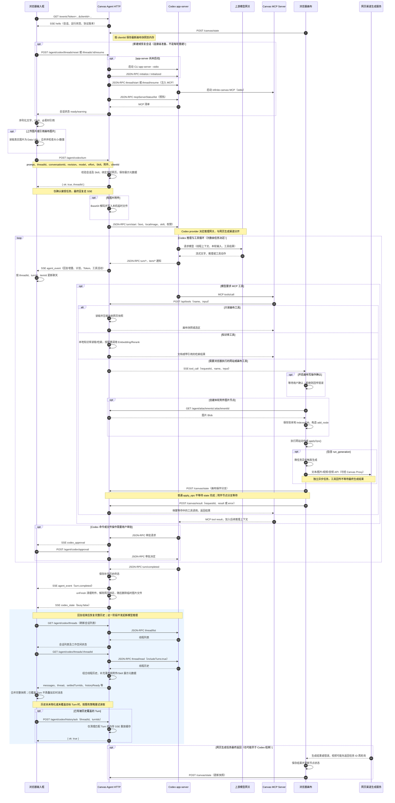

# Codex 提示词工作流程

本文说明用户从 Codex 输入框提交提示词，到聊天面板显示回复或画布产生实际变化的完整调用链。

分析范围是当前 `AgentPanel → LocalAgentPanel` 使用的本地 Codex 聊天链路。依据工作区现有代码，包括尚未提交的知识库 Rerank 改动；文中的本机网关配置与项目默认配置分开说明。

## 核心结论

Codex 不直接操作浏览器 DOM、React 状态或 Zustand Store，但可以在其权限范围内执行本地命令、读写文件。

页面操作通过结构化 MCP 工具调用交给浏览器执行，执行结果再返回 Codex，形成以下闭环：

```text
用户提示词
  -> Canvas Agent
  -> Codex 推理
  -> MCP 工具调用
  -> 浏览器确认并执行
  -> 结果返回 Codex
  -> Codex 继续推理或结束任务
```

## 完整时序图



图中模型网关的请求细节由 Codex CLI 管理；网页生成服务使用独立渠道配置。SSE 流式事件会与工具执行交错，生成结果的返回时间也不固定，图中不表示它必须等到历史确认后才返回。

## 接口调用说明

### 1. 建立实时连接

```http
GET /events?token=<token>&clientId=<clientId>
```

前端通过 `EventSource` 建立 SSE 长连接，接收以下事件：

- `hello`：连接初始化、当前线程、Turn 和待审批状态。
- `codex_state`：Codex 是否正在执行。
- `agent_event`：回复、推理、计划、工具和 Turn 事件。
- `tool_call`：需要浏览器执行的站点或画布工具。
- `codex_approval`：命令执行或文件修改审批。

代码入口：

- `web/src/components/agent/local-agent-panel.tsx`
- `canvas-agent/src/server/http.ts`
- `canvas-agent/src/canvas/session.ts`

### 2. 同步画布状态

```http
POST /canvas/state?token=<token>&clientId=<clientId>
```

浏览器在连接成功和画布发生变化时，上报节点、连线、选区和视口快照。

快照只保存在 Canvas Agent 进程内存中，供 `canvas_get_state` 等工具读取，不写入浏览器 IndexedDB。

### 3. 提交提示词

```http
POST /agent/codex/turn
```

主要参数：

```ts
{
  prompt,
  messageText,
  messageId,
  clientId,
  threadId,
  conversationId,
  expectedRevision,
  permissionMode,
  model,
  effort,
  skill,
  attachments,
  messageMetadata
}
```

后端会校验：

- 发起任务的网页仍保持 SSE 连接。
- `threadId` 与当前活跃会话一致。
- `conversationId` 和 `revision` 没有过期。
- Codex 对话和 MCP 已初始化完成。
- Skill 真实存在且处于启用状态。

校验通过后，接口立即返回：

```json
{
  "ok": true,
  "threadId": "..."
}
```

最终结果通过 SSE 异步推送，不通过该 HTTP 请求长时间等待。

### 4. 启动 Codex Turn

Canvas Agent 调用 Codex app-server：

```text
JSON-RPC: turn/start
```

通信方式：

```text
Canvas Agent
  -> Codex 子进程 stdin
  <- Codex 子进程 stdout
```

`turn/start` 包含：

- 提示词文本。
- 本地图片路径。
- 显式选择的 Skill。
- 模型和推理强度。
- 审批策略和沙箱权限。

Codex 执行期间会持续发送 `turn/started`、`item/*`、`turn/completed` 等通知。

### 5. Codex 调用 MCP 工具

每个普通 Codex Thread 都会配置 `infinite-canvas` MCP Server。

当 Codex 判断需要读取或修改页面时，会发起：

```text
MCP tools/call
```

MCP Server 校验工具参数后转发到：

```http
POST /api/tools
```

请求内容：

```json
{
  "name": "canvas_apply_ops",
  "input": {
    "ops": []
  }
}
```

### 6. 工具读取或修改画布

只读工具由 Canvas Agent 直接读取内存快照，例如：

- `canvas_get_state`
- `canvas_get_selection`
- `canvas_export_snapshot`

写操作通过 SSE 发给目标浏览器：

```text
event: tool_call
data: {
  requestId,
  name,
  input
}
```

前端收到后：

1. 判断是否为写操作。
2. 根据配置决定是否等待用户确认。
3. 调用 `applyOps()` 修改画布。
4. 将新的节点、连线、选区和视口写入 React 状态。
5. 如果包含 `run_generation`，调用现有生成服务。

### 7. 回传工具结果

浏览器执行完成后调用：

```http
POST /canvas/result?clientId=<clientId>
```

成功：

```json
{
  "requestId": "...",
  "result": {}
}
```

失败或用户拒绝：

```json
{
  "requestId": "...",
  "error": "..."
}
```

Canvas Agent 使用 `requestId` 找到等待中的工具 Promise，将结果依次返回：

```text
浏览器
  -> Canvas Agent
  -> MCP Server
  -> Codex app-server
```

Codex 可以根据工具结果继续推理、调用下一个工具或生成最终回复。

### 8. 完成任务并恢复权威历史

收到 `turn/completed` 后：

1. Canvas Agent 先保存补充历史，再通过 SSE 广播 Turn 终态。
2. `onFinish` 清理本轮附件、解除网页绑定，并发送 `codex_state { busy: false }`。
3. 前端处理 `turn.completed` 时结束流式显示；处理忙闲状态结束时调用 `loadThreads()`，先读线程列表，再读当前线程历史。
4. Agent 将 Codex 线程历史、已落盘的补充事件及用户消息展示元数据组成历史响应。
5. 前端按 `threadId + turnId + itemId` 合并；已成为权威历史的 Turn 不再重复叠加实时消息。历史尚未物化时会重试读取。
6. 前端只对已经覆盖的 `settledTurnIds` 发送 `POST /agent/codex/history/ack`，Agent 清理相应内存重放缓存。

`history/ack` 不删除 Codex 会话文件、消息附件预览或持久化补充历史。

### 9. 截图中的两个历史接口

**`GET /agent/codex/threads/:threadId`：取指定会话的完整历史快照。**

SSE 用于即时显示回复，但可能发生断线、漏事件、历史尚未落盘或页面刷新。因此前端在任务结束、恢复连接或查看历史时，需要重新取得可以用于恢复聊天列表的完整数据。

Agent 内部通过 `thread/read` 读取 Codex 历史，再组合持久化补充事件和用户消息展示元数据。返回结构包括：

```ts
{
  ok: true,
  workspace,
  conversation,
  thread,             // 会话摘要
  messages,           // 完整聊天展示消息
  settledTurnIds,     // 已有终态历史覆盖的轮次
  historyReady        // Codex 线程历史是否已经物化
}
```

前端将这些消息与仍在执行、尚未被快照覆盖的实时消息合并，更新聊天列表。这个 GET 不提交新提示词、不启动新 Turn，也不调用模型生成新回复。

**`POST /agent/codex/history/ack`：确认历史已经覆盖哪些轮次。**

前端合并历史后，把已覆盖的 Turn ID 发回 Agent，例如：

```json
{
  "threadId": "thread-1",
  "turnIds": ["turn-1", "turn-2"]
}
```

Agent 在 `acknowledgeCodexHistory()` 中按 `threadId + turnId` 清理对应内存重放事件，并返回 `{ "ok": true }`。这是前端对历史覆盖情况的确认，不是“用户已读”，也不是把聊天历史上传保存。

可以这样理解：SSE 是执行期间的即时更新，GET 是拿到整理后的会话记录，ack 是告诉 Agent“这些轮次已经包含在我的会话记录里，可以清理它们的临时重放缓存了”。即使 ack 失败，前端合并也已经完成；只是本次缓存清理未获确认，不会因此删除或丢失持久化聊天历史。

## 两条结果路径

### 只回复文字

```text
输入提示词
  -> POST /agent/codex/turn
  -> JSON-RPC turn/start
  -> SSE agent_event
  -> 聊天面板流式显示
```

### 修改页面

```text
输入提示词
  -> POST /agent/codex/turn
  -> JSON-RPC turn/start
  -> MCP tools/call
  -> POST /api/tools
  -> SSE tool_call
  -> 浏览器 applyOps()
  -> POST /canvas/result
  -> MCP tool result
  -> Codex 继续执行
```

## 关键代码位置

- 提示词提交：`web/src/components/agent/local-agent-panel.tsx`
- 前端 Agent API：`web/src/services/api/canvas-agent.ts`
- 画布操作 Bridge：`web/src/pages/canvas/hooks/use-agent-bridge.ts`
- HTTP 接口：`canvas-agent/src/server/http.ts`
- Codex 任务编排：`canvas-agent/src/agent/codex.ts`
- JSON-RPC 客户端：`canvas-agent/src/agent/codex-client.ts`
- JSON-RPC 类型契约：`canvas-agent/src/agent/codex-protocol.ts`
- MCP Server：`canvas-agent/src/server/mcp.ts`
- 工具分发与事件重放：`canvas-agent/src/canvas/session.ts`
- 画布工具转换：`canvas-agent/src/canvas/operations.ts`

## 输入框提交前做了什么

入口是 `agent-chat-composer.tsx → agent-chat-prompt-input.tsx → LocalAgentPanel.sendPrompt()`。

1. 输入框使用 `contentEditable`；普通 Enter 提交，输入法合成期间不会误提交。`/` 选择 Skill，`@` 选择画布素材。
2. Skill 在页面显示为 `/name`，序列化为 `$name`；素材显示和序列化为 `@素材标签`，其真实节点 ID 单独保存在引用列表中。
3. `sendPrompt()` 从 Store 读取提示词、上传附件、当前画布引用、Skill、模型、推理强度和权限模式。
4. 过滤当前画布里已经不存在的引用节点。存在图片引用时，先读取真实图片内容；读取失败则停止提交并显示错误。
5. 组装模型提示词，合并上传图片和画布引用图片；对与上传附件 Data URL 完全相同的引用图片去重，检查数量及请求体大小。
6. 创建 `messageId`，先在聊天列表放一条本地用户消息，清空输入框，再提交 HTTP 请求。
7. 请求拒绝时清除未绑定 Turn 的临时消息；如果用户没有输入新草稿，恢复原提示词、附件和引用。

因此，**用户看到的消息不等于模型收到的完整提示词**：

| 字段 | 用途 |
| --- | --- |
| `messageText` | 聊天历史展示的用户文字，通常不包含系统追加的说明 |
| `prompt` | 用户文字加画布引用说明，服务端还会追加本轮附件说明 |
| `attachments` | 模型视觉输入和创建附件节点所需的原始图片 Data URL |
| `messageMetadata` | 历史展示所需的缩略图、素材引用、Skill 信息，不直接作为 Codex `input` |
| `skill` | 真实 `name/path`，校验后作为结构化 Skill 输入 |

`promptWithCanvasReferences()` 会追加如下信息：

```text
本轮引用的当前画布素材：
1. mention="@图片 1", nodeId="真实节点 ID", title="素材标题", type=image
其中图片素材的实际内容已作为本轮图片附件提供，可直接查看；
nodeId 用于后续画布操作。
需要读取或操作这些素材时，先调用 canvas_get_state，
并使用上面的 nodeId 精确定位，不要按标题猜测节点。
```

服务端 `withAttachmentContext()` 再追加 `attachmentId/name` 清单，并提示需要放入画布时先调用 `canvas_create_attachment_nodes`。

项目的默认 Agent 指令来自 `canvas-agent/agent-instructions.md`：初始化时写入 Agent 工作空间的 `AGENTS.md`，同时作为 MCP Server 的 `instructions`。它约束默认使用当前画布、知识库工具、生成工具，以及禁止用空图片节点假装生成成功。Codex 最终还会组合自己的线程历史、工作空间指令和 Skill 内容；项目并不在浏览器里手动拼接全部模型上下文。

## 网关、地址和认证分别在哪里设置

这里存在多个独立的请求入口，不能用一个“Base URL”概括。

| 环节 | 地址与配置 | 认证 | 请求由谁发出 |
| --- | --- | --- | --- |
| 浏览器 → Canvas Agent | 默认 `http://127.0.0.1:17371`，Agent 连接面板设置 | Canvas Agent 连接 token | 浏览器 |
| Canvas Agent → Codex app-server | `@openai/codex` 依赖中的 CLI，`app-server --stdio` | 使用 Codex 自身配置和认证 | Node 子进程，JSON-RPC |
| Codex → 上游模型网关 | Codex `config.toml` 的 `model_provider/model_providers` | Codex 登录或 provider 配置的凭证 | Codex CLI |
| 浏览器 → 画布生成模型 | 网页「配置 → 渠道」的 Base URL、API Key 和各能力模型 | 渠道 API Key | 浏览器，可选经 Canvas Proxy |
| MCP → Canvas Agent | MCP 启动时读取 `~/.infinite-canvas/canvas-agent.json` 的 `url/token` | `x-canvas-agent-token` | MCP 子进程 |
| Canvas Agent → 知识库模型服务 | `canvas-agent.json` 的 `knowledgeEmbedding/knowledgeRerank` | 独立的 Embedding API Key，Rerank 复用它 | Canvas Agent Node 服务 |

### Canvas Agent 本地入口

- 持久配置：`~/.infinite-canvas/canvas-agent.json`，包含 `url`、随机生成的 `token`、`origins`、工作空间及知识库配置。
- HTTP 服务只监听 `127.0.0.1`；启动时端口优先取 `PORT`，其次取配置 URL 的端口，最后用 `17371`，并回写本机 URL。
- 网页通过 Agent 连接界面填入 URL/token，保存为 `localStorage` 的 `canvas-agent-url`、`canvas-agent-token`。
- `fetchAgentJson()` 给请求 URL 添加 `?token=...`；`EventSource` 也通过查询参数传 token。MCP 使用请求头 `x-canvas-agent-token`。
- `/health`、`/config` 是公开接口；`/config` 只返回 `hasToken`，不返回真实 token。
- 当前 CORS 实现会将**携带正确 token 的新 Origin**加入 `origins` 并保存；不能把现有实现描述成“仅允许第一个 Origin，后续新 Origin 一律拒绝”。
- 当前前后端 Agent 协议版本均为 `6`；SSE `hello` 版本不匹配时前端关闭连接并提示重启。

### Codex 的模型网关

`CodexAppClient.start()` 实际启动：

```text
node <canvas-agent/node_modules/@openai/codex/bin/codex.js> app-server --stdio
```

`spawn()` 没有传单独的 `env`、网关 URL 或 API Key，子进程继承启动 Canvas Agent 的进程环境，使用 Codex 自身配置。通常配置目录是 `~/.codex`；设置了 `CODEX_HOME` 时以对应目录为准。网页聊天面板没有修改 Codex provider 或 API Key 的接口。

本次只读取本机配置中的非密钥字段，发现：

```toml
# 本机 ~/.codex/config.toml 的相关配置摘录；不是项目默认值
model_provider = "webinfra_model"
model = "gpt-5.5-2026-04-24"
model_reasoning_effort = "medium"

[model_providers.webinfra_model]
base_url = "https://ai-coder.bytedance.net/responses"
wire_api = "responses"
```

这说明当前本机 Codex 选择了内部模型网关。切换上游时应在 Codex 配置中修改 provider、Base URL、协议及相应认证，再重启 Canvas Agent，让它重新启动 app-server。若使用 provider 的 `env_key`，对应环境变量需要能被启动 Agent 的进程继承。

**上面的 URL 是 provider Base URL，不能仅凭项目代码推断最终 HTTP URL。** 本仓库只负责 `turn/start`，具体路径拼接、认证头、模型请求体及 HTTP/WebSocket 传输由安装的 Codex CLI 实现。`wire_api = "responses"` 表示采用 Responses 协议，但本次没有抓包，不将最终请求路径或请求次数写成已验证事实。

面板的模型下拉框来自：

```text
GET /agent/codex/models → JSON-RPC model/list
```

选择的 `model`、`effort` 会随每次 `turn/start` 发送；它们可以覆盖本机默认模型和推理强度，但不会改变 provider。前端还会过滤隐藏的自动审查模型，以及没有受支持推理档位的模型。

### 网页渠道与 Canvas Proxy

当 Codex 调用 `canvas_generate_*` 时，后续生成使用网页渠道里的模型和 API Key。它与 Codex 推理模型可以完全不同，例如 Codex 负责理解任务，图片模型负责实际出图。

网页渠道 Base URL 默认是 `https://api.openai.com`；OpenAI 格式请求通过 `buildApiUrl()` 补齐 `/v1`。配置位于 `use-config-store.ts`，实际请求位于 `web/src/services/api/`。

开启「配置 → 本地代理」时：

```text
浏览器
  → http://127.0.0.1:23210/https://真实渠道/v1/接口
  → Canvas Proxy
  → https://真实渠道/v1/接口
```

启动命令为 `npx @basketikun/canvas-proxy@latest`，默认监听 `127.0.0.1:23210`，可通过 `--host/--port` 或 `HOST/PORT` 调整。渠道仍填写真实上游地址；代理只给 HTTP/HTTPS URL 加前缀，转发请求及认证头，并按块透传响应。

**这个代理开关不影响 `/agent/codex/turn`、Agent SSE、MCP 回传或 Codex provider 请求。** Agent API 没有调用 `withLocalProxy()`。不过发送画布远程图片前，`imageToDataUrl()` 的图片下载可能使用该代理。

### 知识库服务配置

知识库页面通过 `/agent/knowledge/embedding`、`/agent/knowledge/rerank` 读取和保存配置，Agent 写入自己的 `canvas-agent.json`，与网页渠道 API Key 分开管理。

- Embedding 默认预设 `https://api.siliconflow.cn/v1`、`BAAI/bge-m3`，默认关闭。
- 当前工作区 Rerank 默认模型为 `Qwen/Qwen3-Reranker-0.6B`，默认关闭，启用时需要明确超时；复用 Embedding 的 Base URL 和 API Key。
- 查询时由 Node 服务发出 `/embeddings`、按需发出 `/rerank` 请求，不使用浏览器 Canvas Proxy 开关。

## 多模态输入如何传递

### 上传、粘贴或拖入图片

当前聊天附件只接受图片：前端筛选 `file.type.startsWith("image/")`，并用 `FileReader.readAsDataURL()` 读取。不在这条聊天链路中上传 PDF、任意文件、音频或视频二进制。

```text
浏览器 File
  → 原始图片 Data URL + MIME/尺寸/文件名
  → POST /agent/codex/turn 的 attachments
  → Canvas Agent Base64 解码
  → os.tmpdir()/infinite-canvas-*.png|webp|jpg
  → turn/start input: { type: "localImage", path: 本机路径 }
  → Codex CLI 读取图片并组织上游视觉请求
```

`codexInput()` 的实际结构：

```ts
{
  threadId: "...",
  input: [
    { type: "text", text: "用户任务及追加说明", text_elements: [] },
    { type: "localImage", path: "/本机临时目录/infinite-canvas-....png" },
    { type: "skill", name: "选中的 Skill", path: "/真实 Skill 路径" }
  ],
  model: "面板选择的模型",
  effort: "面板选择的推理强度",
  approvalPolicy: "on-request",
  sandboxPolicy: { type: "workspaceWrite", networkAccess: false }
}
```

没有图片或 Skill 时省略对应项。Skill 未被文本 `$name` 显式提及时，客户端会在文本前补上该标记。

图片内容不是靠上传公网 URL 传给 Codex，也不是让模型请求 `blob:` 地址。模型最终如何编码图片，由 CLI 完成，项目没有自己组装 `input_image`。

当前既有边界：

- 上传图片与画布引用图片合计最多 `6` 张。
- 前端按 Data URL 字符串长度之和限制在 `28 × 1024 × 1024`；这是编码后的长度，不是原始文件大小。
- Agent Express 的整个 JSON 请求体上限为 `30mb`，还要容纳提示词和展示元数据。
- 原始视觉附件不会因为聊天缩略图压缩而被替换；展示预览长边目标为 `192`。
- Turn 完成或失败后，Agent 清除内存中的本轮附件并删除自己创建的临时文件。

### `@` 引用画布素材

| 引用类型 | 本次提交的内容 | 当前能力边界 |
| --- | --- | --- |
| 图片 | `nodeId` 等文字说明，加真实图片 Data URL | 会成为 Codex `localImage` 视觉输入 |
| 文本 | 引用说明，展示元数据可含文本 | 提交包装不自动展开全文；按提示调用画布工具读取 |
| 视频 | 节点 ID、标题、类型等引用信息 | 不自动抽帧，不转换为 Codex 视频输入 |
| 音频 | 节点 ID、标题、类型等引用信息 | 不自动转写，不转换为 Codex 音频输入 |

`resolveCanvasReferenceImages()` 只处理 `kind === "image"`，优先通过图片存储服务读取本地内容，必要时读取 URL，转换为 Data URL，生成 `id = canvas:<nodeId>` 的附件。

引用音视频意味着“给 Agent 一个可操作的画布节点”，不意味着 Codex 已经听过音频或看完视频。它仍可将这些节点作为画布生成流程的参考素材；视频生成服务会按自身 API 契约处理参考图片、视频及音频。

还有一处限制：`canvas_get_state` 等只读工具通过 `compactNode()` 返回快照，`metadata.content` 超过 `240` 字符时截成前 `120` 字符加省略号。因此不能认为调用一次 `canvas_get_state` 就能读取所有长文本全文或图片内容；图片视觉输入依靠前述附件通道。

### 附件真正放入画布

Codex 看见图片后，如果用户要求把它加入画布：

```text
Codex tools/call: canvas_create_attachment_nodes { attachmentIds }
  → MCP POST /api/tools
  → Agent 校验附件归属于本轮发起网页，并生成真实节点 ID/位置
  → SSE tool_call: canvas_create_attachment_nodes { nodes }
  → 浏览器确认（按设置）
  → GET /agent/attachments/:attachmentId?token=...&clientId=...
  → 浏览器读取 Blob，uploadImage() 保存至本地 IndexedDB
  → applyOps(add_node)
  → POST /canvas/state
  → POST /canvas/result
  → Codex 获得节点 ID，可以继续创建带参考图的生成流程
```

这里的 `uploadImage()` 是本地图片存储，不是上传云端。

聊天历史中的附件缩略图另外保存到 `~/.infinite-canvas/message-metadata/`，用 `agent-asset:` 标识；前端恢复历史时转换为 `/agent/message-assets/:messageKey/:assetFile?token=...` 请求。它与临时模型输入文件、浏览器画布图片存储是三套不同用途的数据。

## Codex 推理、工具执行和生成任务的区别

### app-server 初始化和 MCP 注入

app-server 复用一个子进程，初次启动时：

```text
JSON-RPC initialize（experimentalApi: true）
  → initialized 通知
  → thread/start 或 thread/resume
  → mcpServerStatus/list（预热读取完整工具及认证清单）
  → 会话进入 ready/warning
  → 用户才能发送 turn/start
```

Agent 默认工作空间为 `~/.infinite-canvas/codex-workspaces/site`，可以使用已配置的工作空间路径。新建或恢复 Thread 会注入：

```ts
{
  model_reasoning_summary: "auto",
  mcp_servers: {
    "infinite-canvas": {
      command: "当前 Node 可执行文件",
      args: ["当前 canvas-agent 入口", "mcp"],
      default_tools_approval_mode: "approve",
      startup_timeout_sec: 20,
      tool_timeout_sec: 90
    }
  }
}
```

开发入口为 `.ts` 时启动参数还包含 `tsx`。这条面板链路会自动注入 MCP；用户在外部 Codex App/终端使用画布工具时才涉及插件或手动 `codex mcp add` 的额外安装流程。

### 模型请求不是“一轮只有一次”

项目提交一次 `turn/start` 后，由 Codex 内部执行 Agent 循环：

```text
组合指令、线程历史、本轮文本/图片、Skill 和工具清单
  → 请求模型
  → 模型返回文字或工具动作
  → Codex 执行命令 / 文件操作 / MCP 工具
  → 将结果加入上下文
  → 再请求模型
  → 最终 turn/completed
```

浏览器提交新消息时没有把全部聊天 `messages` 再发一遍，连续上下文由 `threadId` 对应的 Codex 线程维护。不要把前端恢复历史用的 HTTP GET 理解成每次模型推理都必须执行的步骤。

### 工具分三类

| 类别 | 示例 | 实际执行位置 |
| --- | --- | --- |
| 本地画布快照读取 | `canvas_get_state/get_selection/export_snapshot` | Canvas Agent 内存 |
| 知识库读取检索 | `knowledge_list_sources/search/get_document` | Canvas Agent 的本地 SQLite，按需请求检索模型 |
| 网站及画布操作 | `site_navigate`、素材/工作台工具、`canvas_apply_ops` | SSE 定向派发给浏览器 |

`knowledge_search` 不是每条提示词发送前必经的 RAG 步骤；只有 Codex 决定调用该工具时才进入检索链路：

```text
MCP tools/call
  → POST /api/tools
  → KnowledgeStore.search()
  → FTS5 关键词候选 + 按配置执行查询 Embedding/向量检索
  → RRF 融合
  → 按配置执行 Rerank
  → 带来源、行号的切片结果
  → Codex 可继续调用 knowledge_get_document
```

Embedding 失败时回退关键词；当前 Rerank 改动在请求失败时保留精排前排序。详细检索实现见同目录的 [知识库分析](./知识库.md)。

### 生成工具何时返回

`canvas_generate_image/video/audio/text` 在 Agent 中转换为 `canvas_apply_ops`，其中包含生成配置、参考节点连线和 `run_generation`。

浏览器 `useAgentBridge.applyAgentOps()`：

1. 应用普通操作，更新 React 画布状态及 refs。
2. 用 `queueMicrotask()` 调用 `generateNodeRef.current()`，异步启动生成。
3. 立即返回操作后的快照，供 `/canvas/result` 回传。

**所以 MCP 成功只确认这次画布操作成功；它不保证生成 API 成功，更不保证已拿到最终媒体。** 当前快照同步也不是每次都先完成：普通 `canvas_apply_ops` 使用 `void postState()`，附件节点分支则 `await postState()` 后再回传结果。

实际生成进入 `web/src/pages/canvas/project.tsx` 的 `handleGenerateNode()`，根据生成模式调用服务：

| 模式 | OpenAI 格式的既有接口 | 其他分支 |
| --- | --- | --- |
| 文本/带图问答 | `POST /v1/responses`，流式读取 | Gemini `streamGenerateContent?alt=sse` 或自定义模型脚本 |
| 图片 | `POST /v1/images/generations`；带参考图编辑用 `/v1/images/edits` | Gemini `generateContent` 或自定义模型脚本 |
| 视频 | `POST /v1/videos` → `GET /v1/videos/:id` 轮询 → `/content` 或结果 URL 下载 | Gemini `predictLongRunning` → operation 轮询，或自定义模型脚本 |
| 音频 | `POST /v1/audio/speech` | 自定义模型脚本 |

这些请求使用网页渠道配置，结果保存到浏览器本地存储，并更新生成节点；后续画布状态再同步给 Agent。视频/音频参考是否支持、具体请求体与返回格式，取决于所选模型和脚本。

仓库仍有 Responses 函数工具请求等通用能力，但当前 `AgentPanel` 直接挂载 `LocalAgentPanel`；不能因为存在 `/v1/responses` 服务函数，就把当前聊天入口写成浏览器直接执行在线 Agent 循环。

### Codex 内置生图是另一条返回路径

默认 Agent 指令要求普通生成使用画布生成工具；只有用户明确要求 Codex 内置生图 / ImageGen 才使用其内置能力。

当前前端收到属于本网页、非重放的 `item.completed { type: "image_generation" }` 时：

- 从结果中提取 Data URL 或本地图片路径。
- Data URL 在浏览器读取；本地路径通过 `POST /agent/local-image { path }` 读取 Blob。
- 通过图片存储服务保存，并在当前画布插入图片节点。

这条路径不经过网页渠道的 `/images/generations`。

## 审批、标签页归属和中断

### 两层审批

| 权限模式 | Codex 配置 |
| --- | --- |
| `request` | `approvalPolicy: on-request`，Thread 为 `workspace-write`，Turn 为 `workspaceWrite/networkAccess:false` |
| `automatic` | 同上，Thread 配置额外设置 `approvals_reviewer: auto_review` |
| `full` | `approvalPolicy: never`，`danger-full-access/dangerFullAccess` |

这里的 `networkAccess:false` 是 Turn 沙箱执行权限，不代表 Codex 自己不能请求上游模型。

Codex 命令执行、文件修改审批通过 JSON-RPC 服务端请求转成 `codex_approval` SSE，用户操作后：

```text
POST /agent/codex/approval { requestId, decision }
  → resolveCodexApproval()
  → Codex JSON-RPC response
  → codex_approval_resolved SSE
```

MCP 层默认 `approve`，但网页仍通过独立 `confirmTools` 开关，对 `canvas_apply_ops` 和 `canvas_create_attachment_nodes` 显示画布操作确认。它与 Codex 的命令/文件审批不是同一个开关。

### 多标签页

- 每个网页有自己的 `clientId`、SSE 连接及快照。
- 前台切换会调用 `POST /canvas/activate`，更新最近活跃网页。
- 接受 Turn 时 `bindClient(clientId)` 把工具目标固定到发起网页；执行期间切换其他标签页不会重新指派这轮工具。
- `tool_call` 定向发送到目标连接，`/canvas/result` 校验 `requestId + clientId`，附件也校验网页归属。
- 带线程信息的聊天事件目前广播给已连接网页，由前端按当前 `threadId` 筛选；不要将它描述成所有聊天事件仅发送给一个连接。
- 目标网页断开时，待执行工具 Promise 失败，快照被清理；这不等于自动中断 Codex Turn。

当前既有超时为 MCP 启动 `20s`、MCP 工具 `90s`、Agent 等待浏览器工具结果 `30s`。后者包含用户确认耗时，因此确认卡片等待过久也可能先超时，之后回传结果会返回 `409`。

### 停止任务

```text
浏览器停止按钮
  → POST /agent/codex/interrupt { threadId }
  → JSON-RPC turn/interrupt
  → Codex Turn 终态及清理
```

它中断的是 Codex Turn；已经通过 `run_generation` 启动的网页媒体生成是独立异步任务，不能把该接口理解成同时取消所有图片、视频请求。

## 接口速查：一次聊天哪些必经、哪些按需

以下路径相对于 Canvas Agent 地址。除公开接口外，都需要连接 token；浏览器 JSON 请求还可能先触发 CORS `OPTIONS`。

| 接口或协议 | 时机 | 是否每轮必经 |
| --- | --- | --- |
| `GET /config`、`GET /health` | 发现配置、诊断连通性 | 否 |
| `GET /events?token&clientId` | 建立和恢复 SSE | 连接级复用 |
| `POST /canvas/state?token&clientId` | 握手和画布变化，变化上报防抖 `300ms` | 不与每轮一一对应 |
| `POST /canvas/activate?token&clientId` | 网页焦点/可见性变化 | 否 |
| `GET /agent/codex/workspace`、`GET /agent/codex/threads` | 恢复工作空间、会话列表 | 初始化或刷新 |
| `POST /agent/codex/threads/reset` 或 `/agent/codex/threads/new` | 准备新 Thread | 新会话时 |
| `POST /agent/codex/threads/:id/resume` | 切换或恢复历史会话 | 按需 |
| `GET /agent/codex/models`、`GET /agent/codex/skills` | 加载模型和 Skill 选项 | 连接或刷新时 |
| `POST /agent/codex/turn` | 提交本轮提示词和附件 | 是 |
| JSON-RPC `turn/start` | 启动 Codex 本轮执行 | 正常接受后是 |
| Codex → 模型网关 | 模型推理与工具结果续推理 | 由 CLI 内部管理，可多次 |
| MCP `tools/call` → `POST /api/tools` | 读取知识、读取或操作画布/网站 | 按需，可多次 |
| `GET /agent/attachments/:id` | 将本轮图片附件加入画布 | 按需 |
| `POST /canvas/result?clientId` | 回传浏览器工具结果 | 每次网页工具执行 |
| `POST /agent/codex/approval` | 命令/文件审批 | 按需 |
| 网页 → 生成模型接口 | `run_generation` 或工作台生成 | 按需，独立异步 |
| `POST /agent/local-image` | 读取 Codex 内置生图的本地结果 | 按需 |
| `GET /agent/codex/threads` → `GET /agent/codex/threads/:id` | Turn 结束后刷新列表及历史 | 正常完成后的刷新路径 |
| `POST /agent/codex/history/ack` | 确认已取得覆盖 Turn 的历史 | 有已覆盖 Turn 时 |
| `GET /agent/message-assets/:key/:file` | 历史附件缩略图显示 | 按需 |
| `POST /agent/codex/interrupt` | 用户停止 Codex | 按需 |

## 补充代码索引

| 关注内容 | 文件及函数 |
| --- | --- |
| 编辑器与 `/`、`@` 序列化 | `web/src/components/agent/agent-chat-prompt-input.tsx`：`serializeEditor()` |
| 发送参数、SSE、工具结果、历史刷新 | `web/src/components/agent/local-agent-panel.tsx`：`sendPrompt()`、`runToolCall()`、`loadThreadSnapshot()` |
| 提示词追加画布引用、消息归属 | `web/src/components/agent/agent-event-formatters.ts`：`promptWithCanvasReferences()`、`mergeAgentMessages()` |
| 画布引用图片内容读取 | `web/src/lib/canvas/canvas-resource-references.ts`：`resolveCanvasReferenceImages()` |
| 连接地址/token 默认值及保存 | `web/src/stores/use-agent-store.ts` |
| 网页渠道/代理 URL | `web/src/stores/use-config-store.ts`：`buildApiUrl()`、`withLocalProxy()` |
| 本地配置、工作空间、默认指令 | `canvas-agent/src/config.ts`、`canvas-agent/agent-instructions.md` |
| HTTP 接受任务及附件说明 | `canvas-agent/src/server/http.ts`：`/agent/codex/turn`、`withAttachmentContext()` |
| 图片落盘、Thread 复用及清理 | `canvas-agent/src/agent/codex.ts`：`runCodexTurnNow()`、`writeAttachmentFiles()` |
| CLI 启动、JSON-RPC、权限/MCP/多模态输入 | `canvas-agent/src/agent/codex-client.ts`：`start()`、`startTurn()`、`codexConfig()`、`codexInput()` |
| MCP 定义与 HTTP 转发 | `canvas-agent/src/server/mcp.ts`、`canvas-agent/src/canvas/schemas.ts` |
| 网页绑定、附件与工具 Promise | `canvas-agent/src/canvas/session.ts`：`bindClient()`、`callTool()`、`requestCanvasTool()` |
| 高层生成工具转换 | `canvas-agent/src/canvas/operations.ts`：`buildCanvasToolRequest()`、`generationFlowOps()` |
| 前端应用操作与异步生成 | `web/src/pages/canvas/hooks/use-agent-bridge.ts`：`applyAgentOps()` |
| 具体画布生成入口与输入拼装 | `web/src/pages/canvas/project.tsx`：`handleGenerateNode()`；`web/src/components/canvas/canvas-node-generation.ts` |
| 网站/工作台/素材工具执行 | `web/src/lib/agent/agent-site-tools.ts`：`runSiteTool()` |
| 媒体/文本实际 API 请求 | `web/src/services/api/image.ts`、`video.ts`、`audio.ts` |
| 用户消息元数据及历史预览 | `canvas-agent/src/agent/message-metadata.ts`：`recordPending()`、`bindTurn()`、`mergeThread()` |
| 已完成事件补充历史 | `canvas-agent/src/agent/codex-event-history.ts` |
| 知识库搜索与外部检索模型 | `canvas-agent/src/knowledge/store.ts`、`hybrid-search.ts`、`embedding-provider.ts`、`rerank-provider.ts` |
| 浏览器 CORS 转发服务 | `canvas-proxy/index.js` |

以上是静态代码追踪和本机非密钥配置核对结果；没有运行聊天任务或抓取上游流量。最终网关 HTTP 路径、真实认证方式及视觉模型可用性需要结合 Codex CLI 实现或一次实际调用确认。
