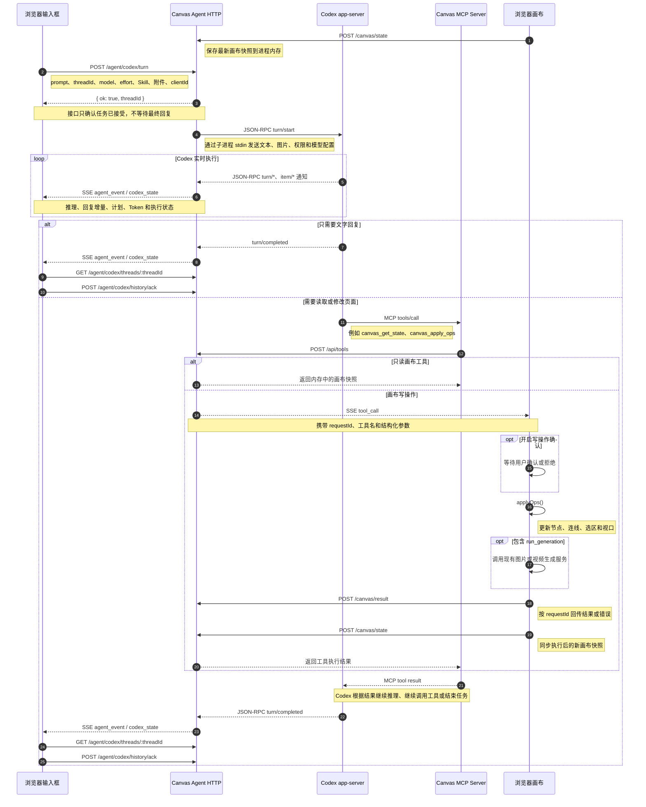

# Codex 提示词工作流程

本文说明用户从 Codex 输入框提交提示词，到聊天面板显示回复或画布产生实际变化的完整调用链。

## 核心结论

Codex 不直接操作浏览器 DOM、React 状态或 Zustand Store。

它只负责理解用户意图并产生文本回复或结构化 MCP 工具调用。真正的页面操作由浏览器执行，执行结果再返回 Codex，形成以下闭环：

```text
用户提示词
  -> Canvas Agent
  -> Codex 推理
  -> MCP 工具调用
  -> 浏览器确认并执行
  -> 结果返回 Codex
  -> Codex 继续推理或结束任务
```

## 完整时序图



## 接口调用说明

### 1. 建立实时连接

```http
GET /events?token=<token>&clientId=<clientId>
```

前端通过 `EventSource` 建立 SSE 长连接，接收以下事件：

- `hello`：连接初始化、当前线程、Turn 和待审批状态。
- `codex_state`：Codex 是否正在执行。
- `agent_event`：回复、推理、计划、工具和 Turn 事件。
- `tool_call`：需要浏览器执行的站点或画布工具。
- `codex_approval`：命令执行或文件修改审批。

代码入口：

- `web/src/components/agent/local-agent-panel.tsx`
- `canvas-agent/src/server/http.ts`
- `canvas-agent/src/canvas/session.ts`

### 2. 同步画布状态

```http
POST /canvas/state?token=<token>&clientId=<clientId>
```

浏览器在连接成功和画布发生变化时，上报节点、连线、选区和视口快照。

快照只保存在 Canvas Agent 进程内存中，供 `canvas_get_state` 等工具读取，不写入浏览器 IndexedDB。

### 3. 提交提示词

```http
POST /agent/codex/turn
```

主要参数：

```ts
{
  prompt,
  messageText,
  messageId,
  clientId,
  threadId,
  conversationId,
  expectedRevision,
  permissionMode,
  model,
  effort,
  skill,
  attachments,
  messageMetadata
}
```

后端会校验：

- 发起任务的网页仍保持 SSE 连接。
- `threadId` 与当前活跃会话一致。
- `conversationId` 和 `revision` 没有过期。
- Codex 对话和 MCP 已初始化完成。
- Skill 真实存在且处于启用状态。

校验通过后，接口立即返回：

```json
{
  "ok": true,
  "threadId": "..."
}
```

最终结果通过 SSE 异步推送，不通过该 HTTP 请求长时间等待。

### 4. 启动 Codex Turn

Canvas Agent 调用 Codex app-server：

```text
JSON-RPC: turn/start
```

通信方式：

```text
Canvas Agent
  -> Codex 子进程 stdin
  <- Codex 子进程 stdout
```

`turn/start` 包含：

- 提示词文本。
- 本地图片路径。
- 显式选择的 Skill。
- 模型和推理强度。
- 审批策略和沙箱权限。

Codex 执行期间会持续发送 `turn/started`、`item/*`、`turn/completed` 等通知。

### 5. Codex 调用 MCP 工具

每个普通 Codex Thread 都会配置 `infinite-canvas` MCP Server。

当 Codex 判断需要读取或修改页面时，会发起：

```text
MCP tools/call
```

MCP Server 校验工具参数后转发到：

```http
POST /api/tools
```

请求内容：

```json
{
  "name": "canvas_apply_ops",
  "input": {
    "ops": []
  }
}
```

### 6. 工具读取或修改画布

只读工具由 Canvas Agent 直接读取内存快照，例如：

- `canvas_get_state`
- `canvas_get_selection`
- `canvas_export_snapshot`

写操作通过 SSE 发给目标浏览器：

```text
event: tool_call
data: {
  requestId,
  name,
  input
}
```

前端收到后：

1. 判断是否为写操作。
2. 根据配置决定是否等待用户确认。
3. 调用 `applyOps()` 修改画布。
4. 将新的节点、连线、选区和视口写入 React 状态。
5. 如果包含 `run_generation`，调用现有生成服务。

### 7. 回传工具结果

浏览器执行完成后调用：

```http
POST /canvas/result?clientId=<clientId>
```

成功：

```json
{
  "requestId": "...",
  "result": {}
}
```

失败或用户拒绝：

```json
{
  "requestId": "...",
  "error": "..."
}
```

Canvas Agent 使用 `requestId` 找到等待中的工具 Promise，将结果依次返回：

```text
浏览器
  -> Canvas Agent
  -> MCP Server
  -> Codex app-server
```

Codex 可以根据工具结果继续推理、调用下一个工具或生成最终回复。

### 8. 完成任务并恢复权威历史

收到 `turn/completed` 后：

1. Canvas Agent 通过 SSE 通知前端任务结束。
2. 前端重新读取当前线程历史。
3. 将 Codex 权威历史、补充历史和实时消息合并去重。
4. 前端发送 `POST /agent/codex/history/ack`。
5. Canvas Agent 清理对应 Turn 的内存重放缓存。

## 两条结果路径

### 只回复文字

```text
输入提示词
  -> POST /agent/codex/turn
  -> JSON-RPC turn/start
  -> SSE agent_event
  -> 聊天面板流式显示
```

### 修改页面

```text
输入提示词
  -> POST /agent/codex/turn
  -> JSON-RPC turn/start
  -> MCP tools/call
  -> POST /api/tools
  -> SSE tool_call
  -> 浏览器 applyOps()
  -> POST /canvas/result
  -> MCP tool result
  -> Codex 继续执行
```

## 关键代码位置

- 提示词提交：`web/src/components/agent/local-agent-panel.tsx`
- 前端 Agent API：`web/src/services/api/canvas-agent.ts`
- 画布操作 Bridge：`web/src/pages/canvas/hooks/use-agent-bridge.ts`
- HTTP 接口：`canvas-agent/src/server/http.ts`
- Codex 任务编排：`canvas-agent/src/agent/codex.ts`
- JSON-RPC 客户端：`canvas-agent/src/agent/codex-client.ts`
- JSON-RPC 类型契约：`canvas-agent/src/agent/codex-protocol.ts`
- MCP Server：`canvas-agent/src/server/mcp.ts`
- 工具分发与事件重放：`canvas-agent/src/canvas/session.ts`
- 画布工具转换：`canvas-agent/src/canvas/operations.ts`
