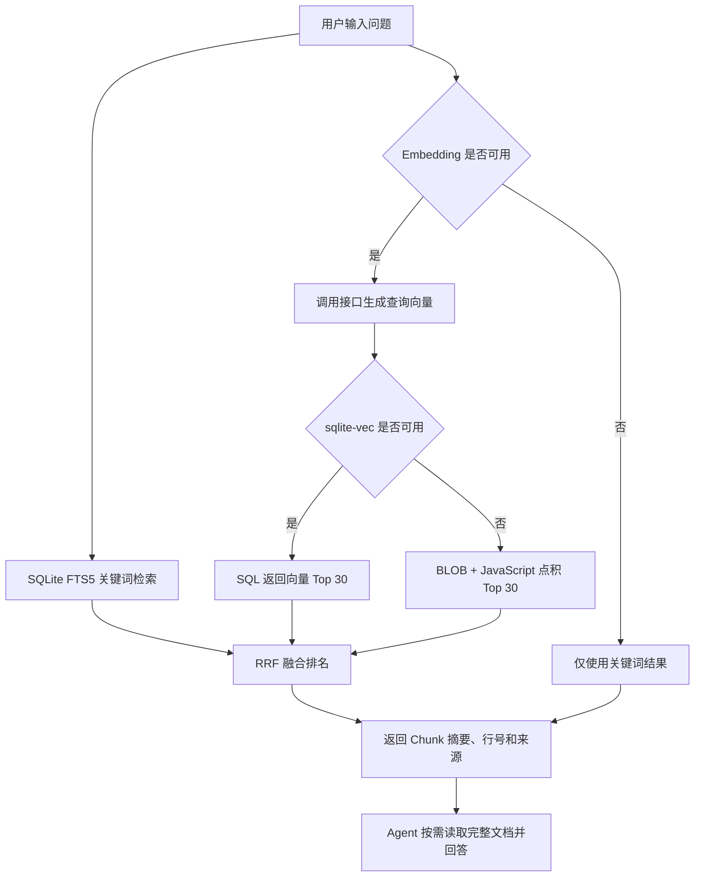

# Infinite Canvas 知识库入门

> 面向第一次接触知识库、RAG、Embedding 和向量检索的读者。

## SQLite 改造状态

本次约定的三阶段 SQLite 改造已经全部实现，当前状态是“代码完成，等待完整测试确认”。

| 阶段 | 状态 | 已实现内容 |
| --- | --- | --- |
| 第一阶段：SQLite 持久化 | 已完成 | 使用 Node.js 24 内置 `node:sqlite`，数据库保存到工作空间内，使用 WAL、事务、相对路径和 schema 版本管理 |
| 第二阶段：FTS5 关键词检索 | 已完成 | 使用 `Intl.Segmenter` 预分词，支持 AND、前缀、BM25 权重和安全参数绑定，schema v1、v2 自动迁移到 v3 |
| 第三阶段：sqlite-vec 向量检索 | 已完成 | `vec0` SQL 返回向量 Top 30，模型维度变化时重建派生表，与 FTS5 结果继续通过 RRF 融合 |
| 跨平台失败保护 | 已完成 | 原生扩展加载、建表或查询失败时回退 Chunk BLOB + JavaScript 点积，不影响 FTS5 和权威数据 |

这里的“全部完成”只指本次 SQLite 三阶段改造。按文档或 Chunk 增量写入、彻底移除内存向量、近似向量索引和文件自动监听仍属于后续增强，不影响当前方案使用。

## Rerank 实现状态

Rerank 二次精排已接入，默认关闭，真实服务效果与页面交互等待测试确认。当前链路为：

```text
FTS5 Top 30 + 向量 Top 30 → RRF 去重融合 → 可选 Rerank → 按 limit 返回（默认 20）
```

在知识库页保存语义检索的 Base URL 和 API Key 后，可单独配置精排模型（预填 `Qwen/Qwen3-Reranker-0.6B`）并填写请求超时秒数，再启用 Rerank。服务必须提供 `POST <Base URL>/rerank` 接口，模型访问权限以服务提供方为准。配置保存在 Canvas Agent 本机，保存后下次检索生效，不需要重新扫描，也不改变 SQLite schema。关闭 Embedding 后仍可对关键词候选精排。

精排发送问题与完整候选切片的标题、正文，要求服务返回全部候选的有效索引和相关性分数，按分数重新排序后再截取。结果保留引用、行号和原 RRF `score`，另加 `rerankScore` 与 `rerankStatus`。页面检索和 MCP `knowledge_search` 共用此链路。

超时秒数没有默认值，必须由用户明确填写；精排失败、超时、缺少共用 Key 或响应候选不完整/索引无效时返回原排序并标记 `fallback`。清除语义检索 Key 后精排无法调用。该功能不包含查询改写、多轮检索或检索验证。

自动化用例覆盖完整 60 个候选、Top20 之外的结果提升、纯关键词精排、关闭开关、HTTP/网络/响应错误以及响应正文读取超时。可在 `canvas-agent/` 运行：

```bash
npx tsx --test src/knowledge/rerank.test.ts src/knowledge/hybrid-search.test.ts
```

## 一句话理解

知识库就是给 AI 准备的一套“可搜索参考资料”。

它不会替代大模型，也不会自己生成答案。它先从本地文件和画布中找到与问题相关的内容，再把这些内容交给 Agent 使用，让回答更贴近用户自己的资料。

```text
用户问题
  ↓
知识库检索相关资料
  ↓
Agent 阅读检索结果
  ↓
结合资料生成回答
```

## 为什么需要知识库

大模型只知道训练时学到的通用知识，不会天然知道：

- 用户项目的 `knowledge/` 目录有哪些文档。
- 当前画布里写了什么提示词。
- 团队自己的业务规则和操作流程。
- 刚刚新增或修改的项目资料。

如果只让模型凭记忆回答，它可能给出宽泛、过时或不符合当前项目的内容。

知识库的作用是先找到可靠资料，再让 Agent 基于资料回答。

## 适合哪些场景

### 查询项目资料

例如项目的 `knowledge/` 目录中有一份图片和视频创作指南，用户可以问：

```text
怎样把写好的宣传文案制作成图片和视频？
```

知识库先找到相关文档，Agent 再整理成步骤。

### 查询画布内容

画布中的文本节点、提示词和生成文本可以同步到知识库。

例如：

```text
当前项目对人物形象有哪些要求？
```

即使要求分散在多个画布节点里，也可以通过检索找到。

### 为 Agent 提供事实依据

Agent 可以通过 MCP 工具搜索知识库和读取完整文档，用检索结果补充上下文，减少凭空猜测。

### 查找同义表达

文档可能写的是：

```text
将静态画面编排成动态视频。
```

用户问的是：

```text
怎样把图片做成短片？
```

关键词不完全相同，但向量语义检索仍可能找到它。

## 知识从哪里来

当前有两类知识来源。

| 来源 | 内容 | 触发方式 |
| --- | --- | --- |
| 知识目录 | `<workspace>/knowledge/` 中的 `.md`、`.txt`、`.ts`、`.tsx` 等文本文件 | 点击“扫描知识目录” |
| 画布 | 文本节点、提示词和生成文本 | 点击“同步画布” |

默认 Agent 工作空间和知识目录分别位于：

```text
~/.infinite-canvas/codex-workspaces/site
~/.infinite-canvas/codex-workspaces/site/knowledge
```

当 Agent 工作空间配置为项目根目录时，项目仓库直接使用根目录的 `knowledge/`。把项目复制到其他目录或 Windows 电脑后，Canvas Agent 会根据当前 `workspacePath` 定位对应的 `knowledge/`，不依赖固定的绝对路径。

扫描只读取 `knowledge/` 内受支持的文本文件，并忽略其中的 `.agents`、`.git`、`.infinite-canvas`、`node_modules`、`dist` 等目录，不会索引项目根目录中的源码或其他文件。目录不存在时会自动创建。

当前没有文件监听，所以修改文件后需要重新点击“扫描知识目录”。画布发生变化后也需要重新同步。

## 从文档到可检索数据

### 第一步：读取文档

扫描知识目录时，Canvas Agent 读取其中支持的文本文件，记录：

- 标题。
- 完整正文。
- 文件路径。
- 修改时间。
- 所属知识来源。

### 第二步：切成 Chunk

一份长文档不适合每次全部交给模型，因此会先切成较小的片段。

每个片段叫作 `Chunk`。

```text
完整文档
  ├── Chunk 1
  ├── Chunk 2
  └── Chunk 3
```

当前规则：

- 每个 Chunk 最多 1200 个字符。
- 相邻 Chunk 重叠 150 个字符。
- 优先在段落或换行处切分。
- 保存 Chunk 对应的起止行号。

重叠的目的是避免一句话刚好被切断，导致上下文丢失。

### 第三步：建立两类索引

每个 Chunk 同时进入两套检索系统：

```text
Chunk
  ├── SQLite FTS5 关键词索引
  └── Embedding 向量索引
```

关键词索引用于寻找相同词语，向量索引用于寻找意思相近的内容。

### 第四步：保存到本地

知识数据保存在：

```text
<workspace>/.infinite-canvas/knowledge.sqlite
```

数据库中当前包含：

- `sources`：知识来源。
- `documents`：完整文档。
- `chunks`：切片、行号、内容哈希和 Float32 BLOB 向量。
- `chunks_fts`：使用 `Intl.Segmenter` 预分词后的 FTS5 关键词索引。
- `vec_chunks`：由 Chunk BLOB 重建的 sqlite-vec 派生向量表。
- `embedding_profile`：生成向量时使用的服务、模型和维度。
- `schema_metadata`：数据库结构版本和派生向量索引的 `dirty` / `clean` 状态。

关键词索引随知识快照一起写入 SQLite，不再在 Agent 启动时重建 MiniSearch。向量查询优先由 sqlite-vec 返回 Top 30；状态为 `clean` 时启动直接复用现有 `vec_chunks`，只有状态为 `dirty` 或表与 Profile 不一致时才从 Chunk BLOB 恢复。同时仍读入内存向量，以便原生扩展不可用时回退 JavaScript 点积。

## 当前 SQLite 与混合检索方案

前三个阶段已经将 JSON 持久化、MiniSearch 关键词索引和主向量查询替换为 SQLite：

```text
knowledge.sqlite
  ├── FTS5 直接查询关键词 Top 30
  └── sqlite-vec 直接查询向量 Top 30
```

写入使用 SQLite 事务整体替换权威知识快照和 FTS5 索引，并将派生向量索引标记为 `dirty`。提交成功后，再从 Chunk BLOB 重建 `vec_chunks`，成功后在同一事务中标记为 `clean`；如果进程在两次事务之间中断，下次首次读取会自动恢复。扩展加载、重建或查询失败只会关闭 SQL 向量能力，不会回滚或破坏权威数据。Embedding 请求和切片仍在事务外完成，旧 `knowledge-v2.json` 不读取、不迁移也不删除。

### 当前方案实际占用哪些内存

Agent 启动后，内存中同时存在：

- 完整文档正文。
- 切片后的 Chunk 正文。
- 从 SQLite BLOB 恢复出的 Base64 向量。
- 解码后的 JavaScript 数字向量。

完整文档和 Chunk 会保留部分重复正文，相邻 Chunk 还有 150 个字符的重叠。向量在数据库中使用 Float32 BLOB，加载后仍会形成 Base64 和 JavaScript `number[]` 两种内存表示。保留这部分内存是为了在 sqlite-vec 原生扩展不可用时跨平台回退，因此第三阶段降低了正常查询的 JavaScript 计算量，但尚未消除向量内存占用。

以当前 1024 维向量为例，一个原始 Float32 向量约占 4 KB；编码成 Base64 后约占 5.3 KB，解码成 JavaScript `number[]` 后通常还会占用更多空间。这只是粗略估算，未包含数组对象、正文和索引开销。

### 当前 FTS5 关键词检索

FTS5 索引持久化在 SQLite 中，查询时由数据库按 BM25 排序并直接返回前 30 个 Chunk ID。

当前实现：

- 标题、正文和引用分别预分词后写入 FTS5。
- 标题、正文和引用的 BM25 权重分别为 3.0、1.0 和 0.5。
- 多个词项使用 `AND`，每个词项支持前缀匹配。
- 查询通过参数绑定执行，原始用户输入不会拼接进 SQL。
- schema v1 会先回填 FTS5 升至 v2，schema v1、v2 最终都会事务迁移到 v3。

当前仍有两个限制：

- 每次重新扫描当前仍按完整知识快照写入事务。
- FTS5 使用应用预分词，分词效果仍依赖运行环境中的 `Intl.Segmenter`。

### 当前 Embedding 向量检索

扫描时生成的 Chunk 向量以 Float32 BLOB 保存在 `knowledge.sqlite`，并派生写入与当前模型维度一致的 `vec_chunks`。

一次查询会：

```text
查询文本
  ↓ Embedding 接口
查询向量
  ↓
sqlite-vec 执行 cosine 距离查询
  ↓
SQL 返回前 30 条
```

如果扩展加载、建表或查询失败，则从同一批 Chunk BLOB 恢复内存向量，沿用 JavaScript 点积 Top 30。FTS5 查询与扩展相互独立，不会因向量回退而失效。

sqlite-vec 0.1.9 当前仍以精确 KNN 为主。如果 Chunk 数量是 `N`，向量维度是 `D`，底层距离计算量仍大致是：

```text
N × D
```

当前维度为 1024，因此 Chunk 数量较大时仍要执行大量距离计算。第三阶段将计算和 Top K 下沉到 SQLite，避免在正常路径由 JavaScript 全量排序，但它不是近似向量索引，数据继续增长后仍需评估其他方案。

### 为什么当前阶段可以继续使用

当前知识库主要面向单个用户、本地工作区和少量画布文本，SQLite 第三阶段方案具有明显优势：

- 没有额外服务和部署成本。
- 单文件可以随项目复制，并通过事务保护整体替换。
- Node.js 24 内置 SQLite，不需要额外数据库服务或驱动依赖。
- 保留现有切片、Embedding、混合检索、页面和 MCP 协议。

因此，当前方案并不是错误方案，而是有明确适用范围的本地实现。

### 数据库不等于完全不用内存

工业软件通常会把文档、Chunk 和向量持久化到数据库，但数据库检索仍会使用：

- 数据库页缓存。
- 操作系统文件缓存。
- 倒排索引的热点数据。
- 向量索引的部分内存结构。

真正的区别是：

> 数据库可以按需读取、过滤和返回 Top K。当前实现为了保证原生扩展失败时仍可检索，仍会把 Chunk 和向量读入内存；这是明确的跨平台回退成本，不是 SQLite 主查询路径的要求。

### 本地优先项目的完整方案

Infinite Canvas 是本地优先应用，当前已经完成单文件 SQLite 持久化、FTS5 和 sqlite-vec 主查询链路。后续重点是增量更新和降低回退索引的常驻内存。

推荐结构：

```text
<workspace>/.infinite-canvas/knowledge.sqlite
  ├── sources            知识来源
  ├── documents          完整文档
  ├── chunks             切片、行号和内容哈希
  ├── chunks.embedding   已实现：Float32 BLOB 向量
  ├── embedding_profile  已实现：模型和维度
  ├── chunks_fts         已实现：SQLite FTS5 全文索引
  └── vec_chunks         已实现：sqlite-vec 派生向量表
```

关键词检索已经迁移到 SQLite FTS5：

```text
用户查询
  ↓
FTS5 分词与 BM25 排名
  ↓
数据库直接返回关键词 Top 30
```

当前向量检索使用 sqlite-vec：

```text
查询向量
  ↓
数据库执行距离检索
  ↓
数据库直接返回向量 Top 30
```

Canvas Agent 最后仍然使用 RRF 合并两组排名，因此上层搜索结果、页面和 MCP 工具不需要因底层数据库变化而重新设计。

### 数据库方案带来的改进

| 能力 | 当前 SQLite 第三阶段 | SQLite 后续方案 |
| --- | --- | --- |
| 持久化 | SQLite 事务整体替换 | 按文档或 Chunk 增量写入 |
| 启动 | 读取 Chunk 和向量，不重建关键词索引 | 按需读取和查询 |
| 关键词 | FTS5 持久化索引 | FTS5 持久化索引 |
| 向量保存 | Float32 BLOB | Float32 BLOB |
| 向量检索 | sqlite-vec SQL Top 30，失败时 JS 回退 | 可扩展的近似向量索引或独立服务 |
| 更新方式 | 完整快照替换 | 按文档或 Chunk 增量更新 |
| 并发与一致性 | Promise 队列 + SQLite 事务 | 更细粒度数据库事务 |
| 条件过滤 | 业务代码过滤 | SQL 按来源、时间和类型过滤 |

### SQLite 是主流 RAG 向量数据库吗

不是。SQLite 是本地嵌入式 RAG 的常见选择，但不能代表所有生产级 RAG 项目的主流方案。

SQLite 本身首先是关系数据库，并不原生提供完整的向量检索能力。需要配合 `sqlite-vec`、SQLite Vec1 或其他向量扩展，才能执行向量距离查询。

RAG 的数据库选择主要取决于运行位置、数据规模、并发量和现有技术栈，不存在所有项目通用的唯一答案。

| 使用场景 | 常用方案 | 主要特点 |
| --- | --- | --- |
| 本地应用、单用户 | SQLite + sqlite-vec、LanceDB | 单文件或嵌入式，不需要独立服务 |
| 快速验证原型 | Chroma | 接入简单，适合实验和小型项目 |
| 已有 PostgreSQL 服务 | PostgreSQL + pgvector | 关系数据、过滤和向量统一管理 |
| 专业向量检索服务 | Qdrant、Milvus、Weaviate | 面向大量向量和独立检索服务 |
| 托管云向量服务 | Pinecone | 平台负责部署、扩容和运维 |
| 全文与向量混合搜索 | Elasticsearch、OpenSearch | 关键词、过滤和向量检索能力完整 |

几类方案可以这样理解：

- SQLite：适合把知识库直接嵌入本地应用。
- pgvector：适合业务数据已经保存在 PostgreSQL 的服务端系统。
- Qdrant、Milvus、Weaviate：更接近专门的向量数据库。
- Elasticsearch、OpenSearch：适合关键词检索和向量检索都很重要的搜索系统。
- Pinecone：适合希望使用托管服务、不自行维护数据库集群的团队。

对于 Infinite Canvas，当前条件是：

```text
本地优先
+ 单用户
+ Canvas Agent 在本机运行
+ 不希望额外部署数据库服务
```

所以 SQLite 是当前项目合适的持久化方案，但这是由项目场景决定的，并不表示 SQLite 是所有 RAG 项目的统一主流数据库。

更贴合实际的选择路线是：

```text
本地单用户
→ SQLite + FTS5 + sqlite-vec

云端多用户，并且已有 PostgreSQL
→ PostgreSQL + pgvector

大量向量或独立检索服务
→ Qdrant / Milvus / Weaviate

全文搜索和向量搜索同样重要
→ Elasticsearch / OpenSearch
```

### 更大规模的服务端方案

如果后续变成多用户服务、跨设备共享知识库或需要处理更大规模数据，可以再选择：

- PostgreSQL + pgvector：关系数据和向量统一管理。
- Qdrant：专门的向量检索服务。
- Milvus：面向大规模向量数据。
- OpenSearch / Elasticsearch：全文检索、过滤和向量检索统一处理。
- LanceDB：适合本地或嵌入式向量数据场景。

这类方案需要额外的部署、鉴权、备份和运维，不适合在当前本地 MVP 阶段直接引入。

### 什么时候应该继续迁移检索层

不需要仅凭某个固定文档数量立即迁移。更实际的判断信号是：

- Agent 启动时读取索引明显变慢。
- `knowledge.sqlite` 体积持续增大，完整快照事务写入耗时明显。
- Agent 内存占用影响其他本地应用。
- 向量线性扫描使搜索延迟无法接受。
- 文件和画布更新频繁，需要真正的增量索引。
- 需要按项目、来源、标签、权限或时间做复杂过滤。

出现这些问题后，再把关键词和向量检索下沉到数据库，比立即引入复杂基础设施更符合当前项目的本地优先定位。

### 推荐的演进顺序

```text
当前阶段
SQLite + FTS5 + sqlite-vec
  ↓
完整快照或回退内存成为瓶颈
增量写入 / 按需回退 / LanceDB
  ↓
多用户、云端和超大规模
pgvector / Qdrant / Milvus / OpenSearch
```

迁移时应该保留现有的稳定概念：

- `sourceId`、`documentId` 和 `chunkId`。
- `contentHash` 增量判断。
- Embedding 模型信息和向量维度。
- 关键词候选与向量候选。
- RRF 混合排序。
- `knowledge_search` 和 `knowledge_get_document` 工具协议。

这样可以只替换底层存储与查询实现，不影响知识库页面和 Agent 使用方式。

## 先区分两个容易混淆的概念

### 切片

切片是把长文档拆成较短的检索单位：

```text
一篇长文档 → 多个 Chunk
```

当前由项目自己的 `chunker.ts` 完成。

### 分词

分词是把一句文本拆成适合关键词索引的词项：

```text
使用提示词生成图片和视频
→ 使用 / 提示词 / 生成 / 图片 / 视频
```

写入 FTS5 时会对 Chunk 分词；执行搜索时也会对用户查询分词。两边使用相同规则，才能进行关键词匹配。

## 三种检索方式

### 1. 关键词检索

关键词检索由 SQLite FTS5 实现。

它会先建立倒排索引：

```text
提示词 → Chunk 1、Chunk 4
图片   → Chunk 1、Chunk 2
视频   → Chunk 2、Chunk 5
```

用户搜索：

```text
图片 视频
```

FTS5 不需要从头遍历全部文档，可以直接找到同时包含这些词的 Chunk。

当前设置：

- 搜索 `title`、`content` 和 `reference`。
- 多个查询词使用 `AND` 组合。
- 支持前缀匹配。
- 最多保留 30 个关键词候选。

它使用 BM25 计算相关性分数，并提高标题字段的权重。

优点：

- 速度快。
- 不需要外部接口。
- 搜索准确名称、代码、路径和专业词汇时效果好。

缺点：

- 主要依赖词语重合。
- 不理解同义词和语义。

例如文档写“动态影像”，用户只搜索“视频”，关键词检索可能找不到。

### 2. 向量语义检索

向量检索会使用 Embedding 模型把文本转换成一组数字。

当前预置：

```text
服务：硅基流动
模型：BAAI/bge-m3
```

可以把向量理解成文本在“语义地图”中的坐标。意思越接近的文本，坐标通常越接近。

建立索引时：

```text
Chunk 正文
  ↓ Embedding 接口
Chunk 向量
  ↓
以 Float32 BLOB 保存到 knowledge.sqlite
```

执行搜索时：

```text
用户问题
  ↓ Embedding 接口
查询向量
  ↓
与本地 Chunk 向量计算相似度
  ↓
取最相近的 30 个候选
```

当前向量会先归一化，因此两个向量的点积可以表示它们的语义相似程度。

优点：

- 能处理同义表达。
- 适合自然语言问题。
- 不要求查询和文档使用完全相同的词。

缺点：

- 扫描和查询都依赖 Embedding 接口。
- 会产生接口耗时和费用。
- 接口不可用时无法执行向量检索。
- 对代码符号、精确编号和文件名不一定比关键词检索好。

### 3. 混合检索

混合检索就是同时使用关键词检索和向量检索。

这是当前项目在 Embedding 可用时采用的默认方式。

```text
用户问题
  ├── SQLite FTS5 → 关键词候选 30 条
  └── Embedding  → 向量候选 30 条
                 ↓
              RRF 融合
                 ↓
           最终结果默认 20 条
```

为什么不直接比较两边的原始分数？

因为 BM25 分数和向量相似度不是同一种单位，直接相加没有明确含义。

项目使用 RRF，也就是“倒数排名融合”：

```text
RRF 分数 = 1 / (60 + 排名)
```

一个 Chunk 如果在关键词结果和向量结果中都排得靠前，会得到两部分分数，因此最终排名通常更高。

优点：

- 兼顾精确关键词和语义理解。
- 比单独使用一种检索方式更稳定。
- 专业词和自然语言问题都能处理。

当前没有单独提供“纯向量模式”。关键词检索始终执行，Embedding 条件满足时再叠加向量结果。

## 什么时候会退化为关键词检索

出现以下任一情况时，搜索只使用 FTS5：

- Embedding 没有开启。
- API Key 或模型配置不完整。
- 当前配置的模型与已有向量模型不一致。
- 还没有扫描出 Chunk 向量。
- 硅基流动接口超时、限流或返回错误。
- 查询向量维度与当前 Embedding Profile 不一致。

页面结果标记可以帮助判断：

| 标记 | 含义 |
| --- | --- |
| `混合检索` | 关键词和向量都参与了检索 |
| `关键词` | 只有 FTS5 参与检索 |

## 一次搜索的完整流程



需要注意：知识库搜索返回的是参考资料，不是最终答案。最终如何组织和表达答案，仍由 Agent 或大模型完成。

## 怎样实际使用

### 建立目录知识

1. 把文本资料放入当前 Agent 工作空间的 `knowledge/` 目录。
2. 打开知识库页面。
3. 确认 Embedding 已配置并开启。
4. 点击“扫描知识目录”。
5. 等待扫描和向量生成完成。

### 建立画布知识

1. 在画布中准备文本、提示词或生成文本节点。
2. 打开知识库页面。
3. 点击“同步画布”。
4. 使用搜索框验证内容。

### 验证关键词检索

文档包含：

```text
使用提示词库生成图片和视频。
```

搜索：

```text
提示词库 图片 视频
```

这是词语高度重合的查询，关键词检索应该能够命中。

### 验证向量语义检索

使用同一份文档，改为搜索：

```text
如何把写好的宣传内容变成静态画面，再编排成动态成片？
```

查询与原文没有完全相同的表达。如果仍然命中正确文档，并显示“混合检索”，说明向量语义检索已经参与。

### 验证 SQLite 三阶段改造

Canvas Agent 需要 Node.js 24 或更高版本。在 `canvas-agent/` 目录执行：

```bash
npx tsx --test \
  src/knowledge/hybrid-search.test.ts \
  src/knowledge/store.test.ts
```

聚焦测试覆盖：

- schema v1、v2 事务迁移到 v3。
- FTS5 中英文 AND、前缀、BM25 权重和特殊字符安全查询。
- sqlite-vec SQL 向量 Top 30。
- Embedding 维度变化后重建 `vec_chunks`。
- 查询 Embedding 维度异常时只返回关键词结果。
- FTS5 与向量候选继续通过 RRF 融合。
- 原生扩展加载失败时保留 Chunk BLOB 和 FTS5，并回退 JavaScript 点积。
- 派生索引为 `dirty` 时重启自动恢复，为 `clean` 时直接复用而不重复重建。
- Agent 重启后恢复相同数据，核心写入失败时回滚权威快照。

测试通过后，再执行一次页面扫描和语义检索，确认实际 Embedding 服务、平台原生扩展和页面结果都正常。

## Agent 如何使用知识库

Canvas Agent 通过 MCP 暴露三个知识工具：

| 工具 | 用途 |
| --- | --- |
| `knowledge_list_sources` | 查看有哪些知识来源 |
| `knowledge_search` | 搜索相关 Chunk |
| `knowledge_get_document` | 按文档 ID 读取完整正文 |

典型过程：

```text
Agent 收到问题
  ↓
knowledge_search 找候选内容
  ↓
查看摘要、来源和行号
  ↓
必要时 knowledge_get_document 读取全文
  ↓
基于资料回答并标明来源
```

## 数据和安全边界

- 知识索引保存在当前工作空间的 `<workspace>/.infinite-canvas/knowledge.sqlite`。
- API Key 保存在 `canvas-agent.json`，不会写入知识索引。
- 前端读取配置时只得到 `hasApiKey`，不会取回真实 API Key。
- 生成文档向量时，Chunk 正文会发送给配置的 Embedding 服务。
- 执行混合检索时，用户查询文本也会发送给 Embedding 服务。
- 当前知识库没有云同步能力。

因此，不应把不允许发送给第三方服务的敏感内容加入启用了远程 Embedding 的知识库。

## 当前能力边界

当前已经具备：

- 项目 `knowledge/` 目录和画布文本知识来源。
- 文档切片和重叠上下文。
- SQLite FTS5 关键词检索。
- OpenAI-compatible Embedding。
- Float32 BLOB 权威向量存储、sqlite-vec SQL Top 30 和 JavaScript 点积回退。
- RRF 混合排名。
- 可选 Rerank 二次精排及失败回退（待人工验收）。
- Embedding 失败时自动退化。
- MCP 搜索和读取完整文档。

当前尚未实现：

- 文件变化自动监听。
- 独立部署的向量数据库服务。
- 自动把知识注入每一次 Agent 对话。
- 图片 OCR、音频识别和视频内容解析。

## 最后用一个比喻记住

可以把知识库想成一个图书馆：

| 知识库概念 | 图书馆中的角色 |
| --- | --- |
| Document | 一本完整的书 |
| Chunk | 书中的几页 |
| 分词 | 给内容制作关键词索引 |
| Embedding | 给内容标记语义坐标 |
| 关键词检索 | 按书名或关键词查目录 |
| 向量检索 | 按“意思相近”找资料 |
| 混合检索 | 同时请目录管理员和语义助手查找 |
| Agent | 阅读找到的资料并整理答案的人 |

最核心的逻辑只有一句话：

> 先把资料整理成可搜索的 Chunk，再用关键词和语义两条路线寻找相关内容，最后让 Agent 基于检索结果回答。

## SQLite 数据库初始化脚本

下面是当前 FTS5 与 `sqlite-vec` 使用的初始化方案。

Canvas Agent 已使用 Node.js 24 内置的 `node:sqlite` 接入核心关系表、schema 版本、WAL、事务写入、FTS5 和 sqlite-vec。现有 `knowledge-v2.json` 不会自动迁移。

目标数据库文件：

```text
<workspace>/.infinite-canvas/knowledge.sqlite
```

数据库路径必须由 Canvas Agent 已解析的 `workspacePath` 通过 `path.join()` 生成，不能依赖启动命令的当前目录。这样同一个项目复制到其他目录或 Windows 电脑后，数据库仍位于对应工作空间内部，例如：

```text
macOS / Linux
/path/to/project/.infinite-canvas/knowledge.sqlite

Windows
C:\path\to\project\.infinite-canvas\knowledge.sqlite
```

SQLite 数据库文件本身可以跨 macOS、Linux 和 Windows 读取，但可移植方案还需要遵循这些约束：

- 工作区文档在数据库中保存相对 `workspacePath` 的引用，不保存 `/Users/...` 或 `C:\Users\...` 等机器绝对路径；需要打开文件时再结合当前 `workspacePath` 解析。
- 画布引用继续使用 `/canvas/<projectId>` 这类与操作系统无关的逻辑路径。
- 复制数据库前先停止写入并关闭连接；使用 WAL 时先执行 checkpoint，不能只复制正在写入的主数据库文件而遗漏 `-wal` 内容。
- 当前核心持久化使用 Node.js 24 内置 SQLite，并通过 npm 的平台可选包加载 `sqlite-vec`；另一台机器需要重新安装与其平台匹配的依赖，不能直接复制 `node_modules`。扩展不可用时会自动回退 JavaScript 点积。
- 同一个数据库快照可以在另一台机器读取，但不支持两台机器分别修改后自动合并；需要指定单一写入端，或在目标机器重新扫描和同步。
- 文档扫描边界固定为 `<workspace>/knowledge/`，并继续忽略该目录内可能出现的 `.infinite-canvas`，避免数据库或临时文件被再次扫描。

### 设计说明

这套表结构继续保留当前知识库的核心概念：

```text
sources
  ↓ 一对多
documents
  ↓ 一对多
chunks
  ├── chunks_fts：关键词索引
  └── vec_chunks：向量索引
```

几个重要决定：

- `sources`、`documents`、`chunks` 使用当前已有的稳定字符串 ID。
- Chunk 继续保存 `contentHash`，用于判断内容是否变化。
- FTS5 保存预分词字段，复用当前 `Intl.Segmenter` 的中英文分词结果。
- 数据库中的 Embedding 使用 Float32 BLOB，不再以 Base64 持久化。
- `vec_chunks` 的维度来自当前 `embedding_profile.dimensions`；`BAAI/bge-m3` 当前通常为 1024 维，但实现不把维度写死。
- 关键词 Top 30 和向量 Top 30 仍由 Canvas Agent 使用 RRF 合并。

### 第一部分：核心 SQLite 与 FTS5

下面这部分只依赖 SQLite 自带能力，可以直接作为初始化 SQL 执行。

```sql
PRAGMA foreign_keys = ON;
PRAGMA journal_mode = WAL;

BEGIN IMMEDIATE;

-- 保存数据库结构版本，v1 会先创建 FTS5 升至 v2，再迁移到 v3。
CREATE TABLE schema_metadata (
    key TEXT PRIMARY KEY NOT NULL,
    value TEXT NOT NULL
);

INSERT INTO schema_metadata (key, value)
VALUES ('schema_version', '3');

INSERT INTO schema_metadata (key, value)
VALUES ('vector_index_state', 'dirty');

-- 知识来源，例如 workspace 或 canvas。
CREATE TABLE sources (
    id TEXT PRIMARY KEY NOT NULL,
    kind TEXT NOT NULL CHECK (kind IN ('workspace', 'canvas')),
    title TEXT NOT NULL,
    reference TEXT NOT NULL,
    document_count INTEGER NOT NULL CHECK (document_count >= 0),
    updated_at TEXT NOT NULL
);

CREATE TABLE documents (
    id TEXT PRIMARY KEY NOT NULL,
    source_id TEXT NOT NULL REFERENCES sources(id) ON DELETE CASCADE,
    source_kind TEXT NOT NULL CHECK (source_kind IN ('workspace', 'canvas')),
    title TEXT NOT NULL,
    content TEXT NOT NULL,
    reference TEXT NOT NULL,
    updated_at TEXT NOT NULL,
    metadata_json TEXT
);

CREATE TABLE chunks (
    id TEXT PRIMARY KEY NOT NULL,
    document_id TEXT NOT NULL REFERENCES documents(id) ON DELETE CASCADE,
    source_id TEXT NOT NULL REFERENCES sources(id) ON DELETE CASCADE,
    source_kind TEXT NOT NULL CHECK (source_kind IN ('workspace', 'canvas')),
    title TEXT NOT NULL,
    content TEXT NOT NULL,
    reference TEXT NOT NULL,
    updated_at TEXT NOT NULL,
    start_line INTEGER NOT NULL CHECK (start_line > 0),
    end_line INTEGER NOT NULL CHECK (end_line >= start_line),
    content_hash TEXT NOT NULL,
    embedding BLOB,
    metadata_json TEXT
);

-- 记录当前有效的 Embedding 配置，不保存 API Key。
CREATE TABLE embedding_profile (
    id INTEGER PRIMARY KEY CHECK (id = 1),
    base_url TEXT NOT NULL,
    model TEXT NOT NULL,
    dimensions INTEGER NOT NULL CHECK (dimensions > 0)
);

-- chunk_id 不参与索引；其他字段由应用提前分词并用空格连接。
CREATE VIRTUAL TABLE chunks_fts USING fts5(
    chunk_id UNINDEXED,
    title_terms,
    content_terms,
    reference_terms,
    tokenize = 'unicode61'
);

COMMIT;
```

当前按完整快照写入，因此 `chunks` 和 `chunks_fts` 在同一个事务中先清空再逐条写入，不依赖触发器。v1 升级时只创建 `chunks_fts`、回填已有 Chunk 并在提交前把版本改为 v2；任一步失败都会回滚。

### 第二部分：加载 sqlite-vec 后创建向量表

`vec0` 不是 SQLite 内置模块。Canvas Agent 必须先通过所选 SQLite 驱动加载 `sqlite-vec` 扩展，然后才能执行下面的 SQL。

不要把驱动的 `loadExtension()` 调用写进 SQL 文件；扩展加载属于 Node.js 初始化代码。

```sql
BEGIN IMMEDIATE;

-- 当前 BAAI/bge-m3 返回 1024 维向量。
--
-- 因为应用已经对向量做归一化，使用 cosine 距离和当前点积排序
-- 具有相同的相关性方向。
DROP TABLE IF EXISTS vec_chunks;

CREATE VIRTUAL TABLE vec_chunks USING vec0(
    chunk_id TEXT PRIMARY KEY,
    embedding FLOAT[1024] DISTANCE_METRIC = cosine
);

COMMIT;
```

实际实现不使用触发器。`chunks.embedding` 是权威向量数据，`vec_chunks` 是可丢弃、可重建的派生索引：核心快照和 FTS5 事务提交时把 `vector_index_state` 标记为 `dirty`，随后应用删除并按当前 `embedding_profile.dimensions` 重建向量表，成功后标记为 `clean`。正常启动直接复用 clean 索引；异常中断留下的 dirty 索引会在下次首次读取时恢复。这样即使 Windows 或其他平台的原生扩展加载失败，也不会影响 Chunk 与关键词检索。

实际代码会读取 `embedding_profile.dimensions` 动态生成 `FLOAT[维度]`。如果更换 Embedding 模型并改变向量维度，会执行：

1. 删除或重建 `vec_chunks`。
2. 更新 `embedding_profile`。
3. 为所有 Chunk 重新生成向量。
4. 不允许把不同模型或不同维度的向量混在同一张向量表中。

### 写入来源、文档和 Chunk 的事务示例

下面展示一次知识目录扫描如何按来源整体替换，同时保持事务一致性。

实际接入时，循环插入应使用数据库驱动的参数绑定和预编译语句，不要拼接用户文本。

```sql
BEGIN IMMEDIATE;

INSERT INTO sources (
    id,
    kind,
    title,
    reference,
    document_count,
    updated_at
)
VALUES (
    :source_id,
    :source_kind,
    :source_title,
    :source_reference,
    :source_document_count,
    :source_updated_at
);

INSERT INTO documents (
    id,
    source_id,
    source_kind,
    title,
    content,
    reference,
    updated_at,
    metadata_json
)
VALUES (
    :document_id,
    :source_id,
    :source_kind,
    :document_title,
    :document_content,
    :document_reference,
    :document_updated_at,
    :document_metadata_json
);

INSERT INTO chunks (
    id,
    document_id,
    source_id,
    source_kind,
    title,
    content,
    reference,
    updated_at,
    start_line,
    end_line,
    content_hash,
    embedding,
    metadata_json
)
VALUES (
    :chunk_id,
    :document_id,
    :source_id,
    :source_kind,
    :chunk_title,
    :chunk_content,
    :chunk_reference,
    :chunk_updated_at,
    :chunk_start_line,
    :chunk_end_line,
    :chunk_content_hash,
    :chunk_embedding,
    :chunk_metadata_json
);

INSERT INTO chunks_fts (
    chunk_id,
    title_terms,
    content_terms,
    reference_terms
)
VALUES (
    :chunk_id,
    :chunk_title_terms,
    :chunk_content_terms,
    :chunk_reference_terms
);

-- Profile 与权威 Chunk BLOB 在核心事务中一起提交。
INSERT INTO embedding_profile (
    id,
    base_url,
    model,
    dimensions
)
VALUES (
    1,
    :embedding_base_url,
    :embedding_model,
    :embedding_dimensions
);

COMMIT;
```

上面的 SQL 只展示一个文档和一个 Chunk。真实写入会先按 `chunks_fts`、`chunks`、`documents`、`sources`、`embedding_profile` 的顺序清空旧快照，再在同一个事务中重复插入完整数据。`:chunk_embedding` 绑定 Float32 BLOB；三个 `*_terms` 参数由应用预分词。

### 关键词 Top 30 查询示例

查询文本也要先使用当前 `tokenizeText()` 规则分词，再构造成安全的 FTS5 查询表达式并绑定到 `:fts_query`。

为了保持原关键词检索的 `AND` 和前缀行为，每个词项需要正确转义，并组合成类似：

```text
"提示词"* AND "图片"* AND "视频"*
```

不能直接把用户原始输入拼接成 FTS5 查询语句。

```sql
SELECT
    chunk_id,
    bm25(chunks_fts, 0, 3.0, 1.0, 0.5) AS keyword_score
FROM chunks_fts
WHERE chunks_fts MATCH :fts_query
ORDER BY keyword_score, rowid
LIMIT 30;
```

`bm25()` 在 FTS5 中是数值越小排名越靠前。这里的权重表示：

- 标题词权重为 3.0。
- 正文词权重为 1.0。
- 路径词权重为 0.5。

`chunk_id` 是 `UNINDEXED` 列，所以对应权重为 0。业务层只需要候选 ID 和顺序，再从已加载的 Chunk 映射组装结果。

### 向量 Top 30 查询示例

`:query_embedding` 必须绑定为与 `vec_chunks` 当前表结构相同维度的 Float32 向量。使用 `BAAI/bge-m3` 时当前通常是 1024 维，实际以 `embedding_profile.dimensions` 为准。

```sql
SELECT
    vec_chunks.chunk_id,
    vec_chunks.distance AS vector_distance
FROM vec_chunks
WHERE vec_chunks.embedding MATCH :query_embedding
  AND k = 30
ORDER BY vec_chunks.distance;
```

如果还需要来源或文档内容，可以将向量候选连接回 `chunks`：

```sql
WITH vector_matches AS (
    SELECT
        chunk_id,
        distance
    FROM vec_chunks
    WHERE embedding MATCH :query_embedding
      AND k = 30
)
SELECT
    chunks.id AS chunk_id,
    chunks.document_id,
    chunks.source_id,
    chunks.title,
    chunks.content,
    chunks.reference,
    chunks.start_line,
    chunks.end_line,
    vector_matches.distance
FROM vector_matches
JOIN chunks ON chunks.id = vector_matches.chunk_id
ORDER BY vector_matches.distance;
```

### RRF 仍然由 Canvas Agent 完成

数据库负责分别返回：

```text
关键词排名 Top 30
向量排名 Top 30
```

Canvas Agent 继续按当前规则合并：

```text
RRF 分数 = 1 / (60 + 关键词排名)
         + 1 / (60 + 向量排名)
```

最终取前 20 条。sqlite-vec 已经接入，知识库页面、搜索结果类型和 MCP 工具协议保持不变。

### 初始化和接入顺序

当前接入顺序如下：

1. 已实现：根据当前 `workspacePath` 打开 `.infinite-canvas/knowledge.sqlite`。
2. 已实现：校验 `schema_version`，开启外键并配置 WAL。
3. 已实现：在事务中写入来源、文档、Chunk、Float32 BLOB 向量和 Embedding Profile。
4. 已实现：创建持久化 FTS5 索引，以预分词、AND 和前缀查询执行关键词 Top 30。
5. 已实现：schema v1 启动时先回填 FTS5 升至 v2，v1、v2 最终都事务迁移到 v3。
6. 已实现：加载 `sqlite-vec`、按当前维度重建派生向量表并执行向量 Top 30。
7. 保持不变：在 Canvas Agent 中执行 RRF 并返回前 20 条。

### 初始化脚本的边界

- 这份脚本不会迁移现有 `knowledge-v2.json`。
- `sqlite-vec` 通过 npm 可选平台包提供 macOS、Windows x64 与 Linux 原生扩展；不支持的平台或加载失败会自动回退 JavaScript 点积。
- `sqlite-vec` 当前主要执行精确的暴力 KNN，数据继续增长后仍需评估 LanceDB、pgvector 或专门向量数据库。
- FTS5 的中文效果依赖应用提前分词；不能直接假设默认 `unicode61` 与当前 `Intl.Segmenter` 完全一致。
- 数据库结构升级时必须提升 `schema_version` 并执行明确迁移，不应静默覆盖旧库。

参考：

- [SQLite FTS5 官方文档](https://sqlite.org/fts5.html)
- [sqlite-vec KNN 查询文档](https://asg017.github.io/sqlite-vec/features/knn.html)
