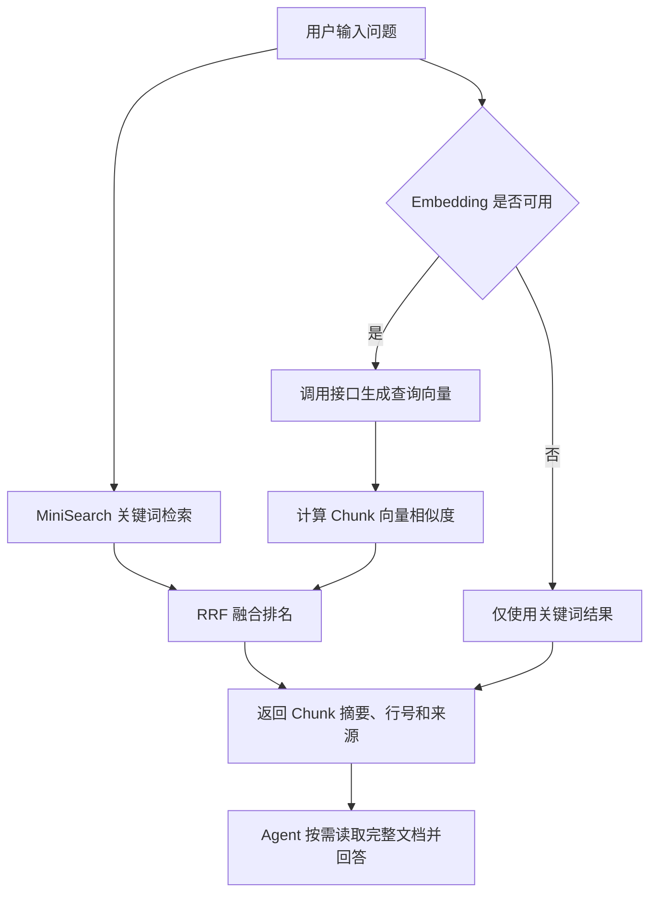

# Infinite Canvas 知识库入门

> 面向第一次接触知识库、RAG、Embedding 和向量检索的读者。

## 一句话理解

知识库就是给 AI 准备的一套“可搜索参考资料”。

它不会替代大模型，也不会自己生成答案。它先从本地文件和画布中找到与问题相关的内容，再把这些内容交给 Agent 使用，让回答更贴近用户自己的资料。

```text
用户问题
  ↓
知识库检索相关资料
  ↓
Agent 阅读检索结果
  ↓
结合资料生成回答
```

## 为什么需要知识库

大模型只知道训练时学到的通用知识，不会天然知道：

- 用户本地工作区有哪些文档。
- 当前画布里写了什么提示词。
- 团队自己的业务规则和操作流程。
- 刚刚新增或修改的项目资料。

如果只让模型凭记忆回答，它可能给出宽泛、过时或不符合当前项目的内容。

知识库的作用是先找到可靠资料，再让 Agent 基于资料回答。

## 适合哪些场景

### 查询项目资料

例如工作区中有一份图片和视频创作指南，用户可以问：

```text
怎样把写好的宣传文案制作成图片和视频？
```

知识库先找到相关文档，Agent 再整理成步骤。

### 查询画布内容

画布中的文本节点、提示词和生成文本可以同步到知识库。

例如：

```text
当前项目对人物形象有哪些要求？
```

即使要求分散在多个画布节点里，也可以通过检索找到。

### 为 Agent 提供事实依据

Agent 可以通过 MCP 工具搜索知识库和读取完整文档，用检索结果补充上下文，减少凭空猜测。

### 查找同义表达

文档可能写的是：

```text
将静态画面编排成动态视频。
```

用户问的是：

```text
怎样把图片做成短片？
```

关键词不完全相同，但向量语义检索仍可能找到它。

## 知识从哪里来

当前有两类知识来源。

| 来源 | 内容 | 触发方式 |
| --- | --- | --- |
| 工作区 | `.md`、`.txt`、`.ts`、`.tsx` 等文本文件 | 点击“扫描工作区” |
| 画布 | 文本节点、提示词和生成文本 | 点击“同步画布” |

工作区默认位于：

```text
~/.infinite-canvas/codex-workspaces/site
```

扫描会忽略 `.agents`、`.git`、`node_modules`、`dist` 等目录，不会把 Skill 内部资料加入用户知识库。

当前没有文件监听，所以修改文件后需要重新点击“扫描工作区”。画布发生变化后也需要重新同步。

## 从文档到可检索数据

### 第一步：读取文档

扫描工作区时，Canvas Agent 读取支持的文本文件，记录：

- 标题。
- 完整正文。
- 文件路径。
- 修改时间。
- 所属知识来源。

### 第二步：切成 Chunk

一份长文档不适合每次全部交给模型，因此会先切成较小的片段。

每个片段叫作 `Chunk`。

```text
完整文档
  ├── Chunk 1
  ├── Chunk 2
  └── Chunk 3
```

当前规则：

- 每个 Chunk 最多 1200 个字符。
- 相邻 Chunk 重叠 150 个字符。
- 优先在段落或换行处切分。
- 保存 Chunk 对应的起止行号。

重叠的目的是避免一句话刚好被切断，导致上下文丢失。

### 第三步：建立两类索引

每个 Chunk 同时进入两套检索系统：

```text
Chunk
  ├── MiniSearch 关键词索引
  └── Embedding 向量索引
```

关键词索引用于寻找相同词语，向量索引用于寻找意思相近的内容。

### 第四步：保存到本地

知识数据保存在：

```text
~/.infinite-canvas/knowledge-v2.json
```

文件中主要包含：

- `sources`：知识来源。
- `documents`：完整文档。
- `chunks`：切片、行号和向量。
- `embeddingProfile`：生成向量时使用的服务、模型和维度。

MiniSearch 的内存索引不会直接保存。Canvas Agent 启动时会读取 `knowledge-v2.json`，再根据其中的 Chunk 重建索引。

## 当前存储方案与后续数据库方案

当前实现优先追求简单、可运行和本地优先，因此使用：

```text
knowledge-v2.json
  ↓ Agent 启动时完整读取
KnowledgeStore 内存数据
  ├── MiniSearch 关键词索引
  └── 全部 Chunk 向量
```

这个方案是有效的 RAG 实现，但定位是小规模本地知识库，不是最终的大规模存储架构。

### 当前方案实际占用哪些内存

Agent 启动后，内存中同时存在：

- 完整文档正文。
- 切片后的 Chunk 正文。
- JSON 中 Base64 编码的向量。
- 解码后的 JavaScript 数字向量。
- MiniSearch 建立的词项和倒排索引。

完整文档和 Chunk 会保留部分重复正文，相邻 Chunk 还有 150 个字符的重叠。向量也同时存在 Base64 和解码后的两种表示，因此实际内存占用会高于 `knowledge-v2.json` 的文件大小。

以当前 1024 维向量为例，一个原始 Float32 向量约占 4 KB；编码成 Base64 后约占 5.3 KB，解码成 JavaScript `number[]` 后通常还会占用更多空间。这只是粗略估算，未包含数组对象、正文和索引开销。

### 当前 MiniSearch 的扩展性

MiniSearch 本身就是内存全文检索库。

它的优点是：

- 不需要安装数据库。
- 建立索引和查询都很直接。
- 小规模数据下响应快。
- 非常适合本地 MVP 和浏览器应用。

当前 Agent 会把所有 Chunk 加入 MiniSearch。数据量增大后，主要问题包括：

- Agent 启动时必须读取全部 JSON 并重建全部索引。
- 倒排索引会持续占用进程内存。
- 每次重新扫描都要生成完整的新数据文件。
- 频繁增删文档时缺少数据库事务和增量写入能力。

### 当前 Embedding 检索的扩展性

扫描时生成的 Chunk 向量保存在 `knowledge-v2.json`，搜索时全部解码到内存。

一次查询会：

```text
查询文本
  ↓ Embedding 接口
查询向量
  ↓
与内存中的每一个 Chunk 向量计算点积
  ↓
排序并取前 30 条
```

如果 Chunk 数量是 `N`，向量维度是 `D`，一次搜索的计算量大致是：

```text
N × D
```

当前维度为 1024，因此 Chunk 数量较大时，每次查询都要执行大量乘法和排序。它属于全量线性扫描，没有使用专门的向量索引。

### 为什么当前阶段可以继续使用

当前知识库主要面向单个用户、本地工作区和少量画布文本，JSON 方案具有明显优势：

- 没有额外服务和部署成本。
- 数据文件直观，出现问题时容易检查。
- 适合快速验证切片、Embedding 和混合检索效果。
- 当前 API 和 MCP 工具链不需要依赖数据库驱动。

因此，当前方案并不是错误方案，而是有明确适用范围的第一阶段实现。

### 数据库不等于完全不用内存

工业软件通常会把文档、Chunk 和向量持久化到数据库，但数据库检索仍会使用：

- 数据库页缓存。
- 操作系统文件缓存。
- 倒排索引的热点数据。
- 向量索引的部分内存结构。

真正的区别是：

> 数据库可以按需读取、过滤和返回 Top K，业务进程不必一次性保存和遍历全部正文与向量。

### 本地优先项目的正规化方案

Infinite Canvas 是本地优先应用，后续更适合先迁移到单文件 SQLite，而不是立即部署独立数据库服务。

推荐结构：

```text
~/.infinite-canvas/knowledge.db
  ├── sources            知识来源
  ├── documents          完整文档
  ├── chunks             切片、行号和内容哈希
  ├── embeddings         Float32 向量和模型信息
  ├── chunks_fts         SQLite FTS5 全文索引
  └── 向量扩展           sqlite-vec 或同类方案
```

关键词检索可以从 MiniSearch 迁移到 SQLite FTS5：

```text
用户查询
  ↓
FTS5 分词与 BM25 排名
  ↓
数据库直接返回关键词 Top 30
```

向量检索可以使用 SQLite 向量扩展或本地向量数据库：

```text
查询向量
  ↓
数据库执行距离检索
  ↓
数据库直接返回向量 Top 30
```

Canvas Agent 最后仍然使用 RRF 合并两组排名，因此上层搜索结果、页面和 MCP 工具不需要因底层数据库变化而重新设计。

### 数据库方案带来的改进

| 能力 | 当前 JSON + 内存 | SQLite + 检索扩展 |
| --- | --- | --- |
| 持久化 | 整体覆盖 JSON | 事务化增删改 |
| 启动 | 完整解析文件并重建 | 按需读取和查询 |
| 关键词 | MiniSearch 全量内存 | FTS5 持久化索引 |
| 向量保存 | Base64 字符串 | Float32 BLOB |
| 向量检索 | JavaScript 全量遍历 | 数据库距离查询 |
| 更新方式 | 按来源整体替换 | 按文档或 Chunk 增量更新 |
| 并发与一致性 | Promise 队列 + 原子重命名 | 数据库事务 |
| 条件过滤 | 业务代码过滤 | SQL 按来源、时间和类型过滤 |

### SQLite 是主流 RAG 向量数据库吗

不是。SQLite 是本地嵌入式 RAG 的常见选择，但不能代表所有生产级 RAG 项目的主流方案。

SQLite 本身首先是关系数据库，并不原生提供完整的向量检索能力。需要配合 `sqlite-vec`、SQLite Vec1 或其他向量扩展，才能执行向量距离查询。

RAG 的数据库选择主要取决于运行位置、数据规模、并发量和现有技术栈，不存在所有项目通用的唯一答案。

| 使用场景 | 常用方案 | 主要特点 |
| --- | --- | --- |
| 本地应用、单用户 | SQLite + sqlite-vec、LanceDB | 单文件或嵌入式，不需要独立服务 |
| 快速验证原型 | Chroma | 接入简单，适合实验和小型项目 |
| 已有 PostgreSQL 服务 | PostgreSQL + pgvector | 关系数据、过滤和向量统一管理 |
| 专业向量检索服务 | Qdrant、Milvus、Weaviate | 面向大量向量和独立检索服务 |
| 托管云向量服务 | Pinecone | 平台负责部署、扩容和运维 |
| 全文与向量混合搜索 | Elasticsearch、OpenSearch | 关键词、过滤和向量检索能力完整 |

几类方案可以这样理解：

- SQLite：适合把知识库直接嵌入本地应用。
- pgvector：适合业务数据已经保存在 PostgreSQL 的服务端系统。
- Qdrant、Milvus、Weaviate：更接近专门的向量数据库。
- Elasticsearch、OpenSearch：适合关键词检索和向量检索都很重要的搜索系统。
- Pinecone：适合希望使用托管服务、不自行维护数据库集群的团队。

对于 Infinite Canvas，当前条件是：

```text
本地优先
+ 单用户
+ Canvas Agent 在本机运行
+ 不希望额外部署数据库服务
```

所以 SQLite 是当前项目很合适的下一阶段方案，但这是由项目场景决定的，并不表示 SQLite 是所有 RAG 项目的统一主流数据库。

更贴合实际的选择路线是：

```text
本地单用户
→ SQLite + FTS5 + sqlite-vec

云端多用户，并且已有 PostgreSQL
→ PostgreSQL + pgvector

大量向量或独立检索服务
→ Qdrant / Milvus / Weaviate

全文搜索和向量搜索同样重要
→ Elasticsearch / OpenSearch
```

### 更大规模的服务端方案

如果后续变成多用户服务、跨设备共享知识库或需要处理更大规模数据，可以再选择：

- PostgreSQL + pgvector：关系数据和向量统一管理。
- Qdrant：专门的向量检索服务。
- Milvus：面向大规模向量数据。
- OpenSearch / Elasticsearch：全文检索、过滤和向量检索统一处理。
- LanceDB：适合本地或嵌入式向量数据场景。

这类方案需要额外的部署、鉴权、备份和运维，不适合在当前本地 MVP 阶段直接引入。

### 什么时候应该开始迁移

不需要仅凭某个固定文档数量立即迁移。更实际的判断信号是：

- Agent 启动时读取索引明显变慢。
- `knowledge-v2.json` 体积持续增大，整体写入耗时明显。
- Agent 内存占用影响其他本地应用。
- 向量线性扫描使搜索延迟无法接受。
- 文件和画布更新频繁，需要真正的增量索引。
- 需要按项目、来源、标签、权限或时间做复杂过滤。

出现这些问题后，再迁移数据库比提前引入复杂基础设施更符合当前项目的本地优先定位。

### 推荐的演进顺序

```text
当前阶段
JSON + MiniSearch + 内存向量
  ↓
本地规模增大
SQLite + FTS5 + Float32 向量
  ↓
本地向量查询成为瓶颈
SQLite 向量扩展或 LanceDB
  ↓
多用户、云端和超大规模
pgvector / Qdrant / Milvus / OpenSearch
```

迁移时应该保留现有的稳定概念：

- `sourceId`、`documentId` 和 `chunkId`。
- `contentHash` 增量判断。
- Embedding 模型信息和向量维度。
- 关键词候选与向量候选。
- RRF 混合排序。
- `knowledge_search` 和 `knowledge_get_document` 工具协议。

这样可以只替换底层存储与查询实现，不影响知识库页面和 Agent 使用方式。

## 先区分两个容易混淆的概念

### 切片

切片是把长文档拆成较短的检索单位：

```text
一篇长文档 → 多个 Chunk
```

当前由项目自己的 `chunker.ts` 完成。

### 分词

分词是把一句文本拆成适合关键词索引的词项：

```text
使用提示词生成图片和视频
→ 使用 / 提示词 / 生成 / 图片 / 视频
```

建立 MiniSearch 索引时会对 Chunk 分词；执行搜索时也会对用户查询分词。两边使用相同规则，才能进行关键词匹配。

## 三种检索方式

### 1. 关键词检索

关键词检索由 MiniSearch 实现。

它会先建立倒排索引：

```text
提示词 → Chunk 1、Chunk 4
图片   → Chunk 1、Chunk 2
视频   → Chunk 2、Chunk 5
```

用户搜索：

```text
图片 视频
```

MiniSearch 不需要从头遍历全部文档，可以直接找到同时包含这些词的 Chunk。

当前设置：

- 搜索 `title`、`content` 和 `reference`。
- 多个查询词使用 `AND` 组合。
- 支持前缀匹配。
- 最多保留 30 个关键词候选。

它还会根据词频、词语稀有度和文本长度计算相关性分数。

优点：

- 速度快。
- 不需要外部接口。
- 搜索准确名称、代码、路径和专业词汇时效果好。

缺点：

- 主要依赖词语重合。
- 不理解同义词和语义。

例如文档写“动态影像”，用户只搜索“视频”，关键词检索可能找不到。

### 2. 向量语义检索

向量检索会使用 Embedding 模型把文本转换成一组数字。

当前预置：

```text
服务：硅基流动
模型：BAAI/bge-m3
```

可以把向量理解成文本在“语义地图”中的坐标。意思越接近的文本，坐标通常越接近。

建立索引时：

```text
Chunk 正文
  ↓ Embedding 接口
Chunk 向量
  ↓
保存到 knowledge-v2.json
```

执行搜索时：

```text
用户问题
  ↓ Embedding 接口
查询向量
  ↓
与本地 Chunk 向量计算相似度
  ↓
取最相近的 30 个候选
```

当前向量会先归一化，因此两个向量的点积可以表示它们的语义相似程度。

优点：

- 能处理同义表达。
- 适合自然语言问题。
- 不要求查询和文档使用完全相同的词。

缺点：

- 扫描和查询都依赖 Embedding 接口。
- 会产生接口耗时和费用。
- 接口不可用时无法执行向量检索。
- 对代码符号、精确编号和文件名不一定比关键词检索好。

### 3. 混合检索

混合检索就是同时使用关键词检索和向量检索。

这是当前项目在 Embedding 可用时采用的默认方式。

```text
用户问题
  ├── MiniSearch → 关键词候选 30 条
  └── Embedding  → 向量候选 30 条
                 ↓
              RRF 融合
                 ↓
           最终结果默认 20 条
```

为什么不直接比较两边的原始分数？

因为 MiniSearch 分数和向量相似度不是同一种单位，直接相加没有明确含义。

项目使用 RRF，也就是“倒数排名融合”：

```text
RRF 分数 = 1 / (60 + 排名)
```

一个 Chunk 如果在关键词结果和向量结果中都排得靠前，会得到两部分分数，因此最终排名通常更高。

优点：

- 兼顾精确关键词和语义理解。
- 比单独使用一种检索方式更稳定。
- 专业词和自然语言问题都能处理。

当前没有单独提供“纯向量模式”。关键词检索始终执行，Embedding 条件满足时再叠加向量结果。

## 什么时候会退化为关键词检索

出现以下任一情况时，搜索只使用 MiniSearch：

- Embedding 没有开启。
- API Key 或模型配置不完整。
- 当前配置的模型与已有向量模型不一致。
- 还没有扫描出 Chunk 向量。
- 硅基流动接口超时、限流或返回错误。

页面结果标记可以帮助判断：

| 标记 | 含义 |
| --- | --- |
| `混合检索` | 关键词和向量都参与了检索 |
| `关键词` | 只有 MiniSearch 参与检索 |

## 一次搜索的完整流程



需要注意：知识库搜索返回的是参考资料，不是最终答案。最终如何组织和表达答案，仍由 Agent 或大模型完成。

## 怎样实际使用

### 建立工作区知识

1. 把文本资料放入工作区。
2. 打开知识库页面。
3. 确认 Embedding 已配置并开启。
4. 点击“扫描工作区”。
5. 等待扫描和向量生成完成。

### 建立画布知识

1. 在画布中准备文本、提示词或生成文本节点。
2. 打开知识库页面。
3. 点击“同步画布”。
4. 使用搜索框验证内容。

### 验证关键词检索

文档包含：

```text
使用提示词库生成图片和视频。
```

搜索：

```text
提示词库 图片 视频
```

这是词语高度重合的查询，关键词检索应该能够命中。

### 验证向量语义检索

使用同一份文档，改为搜索：

```text
如何把写好的宣传内容变成静态画面，再编排成动态成片？
```

查询与原文没有完全相同的表达。如果仍然命中正确文档，并显示“混合检索”，说明向量语义检索已经参与。

## Agent 如何使用知识库

Canvas Agent 通过 MCP 暴露三个知识工具：

| 工具 | 用途 |
| --- | --- |
| `knowledge_list_sources` | 查看有哪些知识来源 |
| `knowledge_search` | 搜索相关 Chunk |
| `knowledge_get_document` | 按文档 ID 读取完整正文 |

典型过程：

```text
Agent 收到问题
  ↓
knowledge_search 找候选内容
  ↓
查看摘要、来源和行号
  ↓
必要时 knowledge_get_document 读取全文
  ↓
基于资料回答并标明来源
```

## 数据和安全边界

- 知识索引保存在用户电脑的 `~/.infinite-canvas/`。
- API Key 保存在 `canvas-agent.json`，不会写入知识索引。
- 前端读取配置时只得到 `hasApiKey`，不会取回真实 API Key。
- 生成文档向量时，Chunk 正文会发送给配置的 Embedding 服务。
- 执行混合检索时，用户查询文本也会发送给 Embedding 服务。
- 当前知识库没有云同步能力。

因此，不应把不允许发送给第三方服务的敏感内容加入启用了远程 Embedding 的知识库。

## 当前能力边界

当前已经具备：

- 工作区和画布文本知识来源。
- 文档切片和重叠上下文。
- MiniSearch 关键词检索。
- OpenAI-compatible Embedding。
- 本地向量存储和相似度计算。
- RRF 混合排名。
- Embedding 失败时自动退化。
- MCP 搜索和读取完整文档。

当前尚未实现：

- 文件变化自动监听。
- 专门的向量数据库。
- Rerank 二次精排。
- 自动把知识注入每一次 Agent 对话。
- 图片 OCR、音频识别和视频内容解析。

## 最后用一个比喻记住

可以把知识库想成一个图书馆：

| 知识库概念 | 图书馆中的角色 |
| --- | --- |
| Document | 一本完整的书 |
| Chunk | 书中的几页 |
| 分词 | 给内容制作关键词索引 |
| Embedding | 给内容标记语义坐标 |
| 关键词检索 | 按书名或关键词查目录 |
| 向量检索 | 按“意思相近”找资料 |
| 混合检索 | 同时请目录管理员和语义助手查找 |
| Agent | 阅读找到的资料并整理答案的人 |

最核心的逻辑只有一句话：

> 先把资料整理成可搜索的 Chunk，再用关键词和语义两条路线寻找相关内容，最后让 Agent 基于检索结果回答。

## SQLite 数据库初始化脚本

下面是后续迁移到 SQLite 时可以使用的初始化方案。

它只用于说明和后续开发准备，目前没有接入 Canvas Agent 代码，也不会自动迁移现有的 `knowledge-v2.json`。

目标数据库文件：

```text
~/.infinite-canvas/knowledge.db
```

### 设计说明

这套表结构继续保留当前知识库的核心概念：

```text
sources
  ↓ 一对多
documents
  ↓ 一对多
chunks
  ├── chunks_fts：关键词索引
  └── vec_chunks：向量索引
```

几个重要决定：

- `sources`、`documents`、`chunks` 使用当前已有的稳定字符串 ID。
- Chunk 继续保存 `contentHash`，用于判断内容是否变化。
- FTS5 保存预分词字段，复用当前 `Intl.Segmenter` 的中英文分词结果。
- Embedding 使用 Float32 BLOB，不再使用 Base64。
- `vec_chunks` 使用当前 `BAAI/bge-m3` 的 1024 维向量。
- 关键词 Top 30 和向量 Top 30 仍由 Canvas Agent 使用 RRF 合并。

### 第一部分：核心 SQLite 与 FTS5

下面这部分只依赖 SQLite 自带能力，可以直接作为初始化 SQL 执行。

```sql
PRAGMA foreign_keys = ON;
PRAGMA journal_mode = WAL;
PRAGMA synchronous = NORMAL;

BEGIN IMMEDIATE;

-- 保存数据库结构版本，后续升级时据此执行明确迁移。
CREATE TABLE IF NOT EXISTS schema_metadata (
    key TEXT PRIMARY KEY NOT NULL,
    value TEXT NOT NULL
) STRICT;

INSERT OR IGNORE INTO schema_metadata (key, value)
VALUES ('schema_version', '1');

-- 知识来源，例如 workspace 或 canvas。
CREATE TABLE IF NOT EXISTS sources (
    id TEXT PRIMARY KEY NOT NULL,
    kind TEXT NOT NULL CHECK (kind IN ('workspace', 'canvas')),
    title TEXT NOT NULL,
    reference TEXT NOT NULL,
    updated_at TEXT NOT NULL
) STRICT;

-- 完整文档。Chunk 搜索结果需要全文时再读取本表。
CREATE TABLE IF NOT EXISTS documents (
    id TEXT PRIMARY KEY NOT NULL,
    source_id TEXT NOT NULL,
    title TEXT NOT NULL,
    content TEXT NOT NULL,
    reference TEXT NOT NULL,
    updated_at TEXT NOT NULL,
    metadata_json TEXT,
    FOREIGN KEY (source_id) REFERENCES sources (id) ON DELETE CASCADE,
    UNIQUE (source_id, reference),
    CHECK (metadata_json IS NULL OR json_valid(metadata_json))
) STRICT;

CREATE INDEX IF NOT EXISTS idx_documents_source
ON documents (source_id);

-- 文档切片。
--
-- title_terms、content_terms、reference_terms 由应用使用与当前
-- tokenizeText 相同的规则提前分词，并以空格连接后写入。
CREATE TABLE IF NOT EXISTS chunks (
    id TEXT PRIMARY KEY NOT NULL,
    document_id TEXT NOT NULL,
    source_id TEXT NOT NULL,
    ordinal INTEGER NOT NULL CHECK (ordinal >= 0),
    title TEXT NOT NULL,
    content TEXT NOT NULL,
    reference TEXT NOT NULL,
    start_line INTEGER NOT NULL CHECK (start_line > 0),
    end_line INTEGER NOT NULL CHECK (end_line >= start_line),
    content_hash TEXT NOT NULL,
    updated_at TEXT NOT NULL,
    metadata_json TEXT,
    title_terms TEXT NOT NULL,
    content_terms TEXT NOT NULL,
    reference_terms TEXT NOT NULL,
    FOREIGN KEY (document_id) REFERENCES documents (id) ON DELETE CASCADE,
    FOREIGN KEY (source_id) REFERENCES sources (id) ON DELETE CASCADE,
    UNIQUE (document_id, ordinal),
    CHECK (metadata_json IS NULL OR json_valid(metadata_json))
) STRICT;

CREATE INDEX IF NOT EXISTS idx_chunks_document
ON chunks (document_id);

CREATE INDEX IF NOT EXISTS idx_chunks_source
ON chunks (source_id);

CREATE INDEX IF NOT EXISTS idx_chunks_content_hash
ON chunks (content_hash);

CREATE INDEX IF NOT EXISTS idx_chunks_updated_at
ON chunks (updated_at);

-- 记录当前有效的 Embedding 配置，不保存 API Key。
--
-- 当前设计一次只维护一套有效向量。更换模型或维度时，
-- 应清空并重建 vec_chunks。
CREATE TABLE IF NOT EXISTS embedding_profile (
    id INTEGER PRIMARY KEY NOT NULL CHECK (id = 1),
    base_url TEXT NOT NULL,
    model TEXT NOT NULL,
    dimensions INTEGER NOT NULL CHECK (dimensions > 0),
    updated_at TEXT NOT NULL
) STRICT;

-- FTS5 外部内容表。
--
-- 实际正文仍保存在 chunks 中，FTS5 只维护全文检索索引，
-- 避免再保存一份用于展示的正文。
CREATE VIRTUAL TABLE IF NOT EXISTS chunks_fts USING fts5(
    title_terms,
    content_terms,
    reference_terms,
    content = 'chunks',
    content_rowid = 'rowid',
    tokenize = 'unicode61'
);

-- chunks 新增后自动写入 FTS5。
CREATE TRIGGER IF NOT EXISTS chunks_fts_after_insert
AFTER INSERT ON chunks
BEGIN
    INSERT INTO chunks_fts (
        rowid,
        title_terms,
        content_terms,
        reference_terms
    )
    VALUES (
        new.rowid,
        new.title_terms,
        new.content_terms,
        new.reference_terms
    );
END;

-- chunks 删除后同步删除 FTS5 索引。
CREATE TRIGGER IF NOT EXISTS chunks_fts_after_delete
AFTER DELETE ON chunks
BEGIN
    INSERT INTO chunks_fts (
        chunks_fts,
        rowid,
        title_terms,
        content_terms,
        reference_terms
    )
    VALUES (
        'delete',
        old.rowid,
        old.title_terms,
        old.content_terms,
        old.reference_terms
    );
END;

-- chunks 更新后先删除旧索引，再写入新索引。
CREATE TRIGGER IF NOT EXISTS chunks_fts_after_update
AFTER UPDATE ON chunks
BEGIN
    INSERT INTO chunks_fts (
        chunks_fts,
        rowid,
        title_terms,
        content_terms,
        reference_terms
    )
    VALUES (
        'delete',
        old.rowid,
        old.title_terms,
        old.content_terms,
        old.reference_terms
    );

    INSERT INTO chunks_fts (
        rowid,
        title_terms,
        content_terms,
        reference_terms
    )
    VALUES (
        new.rowid,
        new.title_terms,
        new.content_terms,
        new.reference_terms
    );
END;

-- 页面来源列表需要的统计视图。
CREATE VIEW IF NOT EXISTS source_summaries AS
SELECT
    sources.id,
    sources.kind,
    sources.title,
    sources.reference,
    sources.updated_at,
    COUNT(documents.id) AS document_count
FROM sources
LEFT JOIN documents ON documents.source_id = sources.id
GROUP BY sources.id;

COMMIT;
```

### 第二部分：加载 sqlite-vec 后创建向量表

`vec0` 不是 SQLite 内置模块。Canvas Agent 必须先通过所选 SQLite 驱动加载 `sqlite-vec` 扩展，然后才能执行下面的 SQL。

不要把驱动的 `loadExtension()` 调用写进 SQL 文件；扩展加载属于 Node.js 初始化代码。

```sql
BEGIN IMMEDIATE;

-- 当前 BAAI/bge-m3 返回 1024 维向量。
--
-- 因为应用已经对向量做归一化，使用 cosine 距离和当前点积排序
-- 具有相同的相关性方向。
CREATE VIRTUAL TABLE IF NOT EXISTS vec_chunks USING vec0(
    chunk_id TEXT PRIMARY KEY,
    embedding FLOAT[1024] DISTANCE_METRIC = cosine
);

-- 删除 Chunk 时同步移除向量。
CREATE TRIGGER IF NOT EXISTS chunks_vector_after_delete
AFTER DELETE ON chunks
BEGIN
    DELETE FROM vec_chunks WHERE chunk_id = old.id;
END;

COMMIT;
```

如果以后更换 Embedding 模型，并且向量维度不再是 1024，需要：

1. 删除或重建 `vec_chunks`。
2. 更新 `embedding_profile`。
3. 为所有 Chunk 重新生成向量。
4. 不允许把不同模型或不同维度的向量混在同一张向量表中。

### 写入来源、文档和 Chunk 的事务示例

下面展示一次工作区扫描如何按来源整体替换，同时保持事务一致性。

实际接入时，循环插入应使用数据库驱动的参数绑定和预编译语句，不要拼接用户文本。

```sql
BEGIN IMMEDIATE;

INSERT INTO sources (
    id,
    kind,
    title,
    reference,
    updated_at
)
VALUES (
    :source_id,
    :source_kind,
    :source_title,
    :source_reference,
    :source_updated_at
)
ON CONFLICT (id) DO UPDATE SET
    kind = excluded.kind,
    title = excluded.title,
    reference = excluded.reference,
    updated_at = excluded.updated_at;

-- 当前扫描策略是按来源整体替换。
-- 级联删除会同步删除 documents、chunks、FTS 索引和 vec_chunks。
DELETE FROM documents
WHERE source_id = :source_id;

INSERT INTO documents (
    id,
    source_id,
    title,
    content,
    reference,
    updated_at,
    metadata_json
)
VALUES (
    :document_id,
    :source_id,
    :document_title,
    :document_content,
    :document_reference,
    :document_updated_at,
    :document_metadata_json
);

INSERT INTO chunks (
    id,
    document_id,
    source_id,
    ordinal,
    title,
    content,
    reference,
    start_line,
    end_line,
    content_hash,
    updated_at,
    metadata_json,
    title_terms,
    content_terms,
    reference_terms
)
VALUES (
    :chunk_id,
    :document_id,
    :source_id,
    :chunk_ordinal,
    :chunk_title,
    :chunk_content,
    :chunk_reference,
    :chunk_start_line,
    :chunk_end_line,
    :chunk_content_hash,
    :chunk_updated_at,
    :chunk_metadata_json,
    :chunk_title_terms,
    :chunk_content_terms,
    :chunk_reference_terms
);

-- :embedding 必须绑定为 Float32 BLOB，不能绑定 Base64 字符串。
INSERT INTO vec_chunks (
    chunk_id,
    embedding
)
VALUES (
    :chunk_id,
    :embedding
);

-- 只有向量成功写入后才更新当前 Profile。
INSERT INTO embedding_profile (
    id,
    base_url,
    model,
    dimensions,
    updated_at
)
VALUES (
    1,
    :embedding_base_url,
    :embedding_model,
    :embedding_dimensions,
    :embedding_updated_at
)
ON CONFLICT (id) DO UPDATE SET
    base_url = excluded.base_url,
    model = excluded.model,
    dimensions = excluded.dimensions,
    updated_at = excluded.updated_at;

COMMIT;
```

上面的 SQL 只展示一个文档和一个 Chunk。真实扫描需要在同一个事务中重复执行 `documents`、`chunks` 和 `vec_chunks` 的插入语句。

### 关键词 Top 30 查询示例

查询文本也要先使用当前 `tokenizeText()` 规则分词，再构造成安全的 FTS5 查询表达式并绑定到 `:fts_query`。

为了保持当前 MiniSearch 的 `combineWith: "AND"` 和 `prefix: true` 行为，每个词项需要正确转义，并组合成类似：

```text
"提示词"* AND "图片"* AND "视频"*
```

不能直接把用户原始输入拼接成 FTS5 查询语句。

```sql
SELECT
    chunks.id AS chunk_id,
    chunks.document_id,
    chunks.source_id,
    chunks.title,
    chunks.content,
    chunks.reference,
    chunks.start_line,
    chunks.end_line,
    bm25(chunks_fts, 3.0, 1.0, 0.5) AS keyword_score
FROM chunks_fts
JOIN chunks ON chunks.rowid = chunks_fts.rowid
WHERE chunks_fts MATCH :fts_query
ORDER BY keyword_score
LIMIT 30;
```

`bm25()` 在 FTS5 中是数值越小排名越靠前。这里的权重表示：

- 标题词权重为 3.0。
- 正文词权重为 1.0。
- 路径词权重为 0.5。

这些权重只是初始化方案，正式采用前应该使用真实知识库查询做效果验证。

### 向量 Top 30 查询示例

`:query_embedding` 必须绑定为与 `vec_chunks` 相同的 1024 维 Float32 向量。

```sql
SELECT
    vec_chunks.chunk_id,
    vec_chunks.distance AS vector_distance
FROM vec_chunks
WHERE vec_chunks.embedding MATCH :query_embedding
  AND k = 30
ORDER BY vec_chunks.distance;
```

如果还需要来源或文档内容，可以将向量候选连接回 `chunks`：

```sql
WITH vector_matches AS (
    SELECT
        chunk_id,
        distance
    FROM vec_chunks
    WHERE embedding MATCH :query_embedding
      AND k = 30
)
SELECT
    chunks.id AS chunk_id,
    chunks.document_id,
    chunks.source_id,
    chunks.title,
    chunks.content,
    chunks.reference,
    chunks.start_line,
    chunks.end_line,
    vector_matches.distance
FROM vector_matches
JOIN chunks ON chunks.id = vector_matches.chunk_id
ORDER BY vector_matches.distance;
```

### RRF 仍然由 Canvas Agent 完成

数据库负责分别返回：

```text
关键词排名 Top 30
向量排名 Top 30
```

Canvas Agent 继续按当前规则合并：

```text
RRF 分数 = 1 / (60 + 关键词排名)
         + 1 / (60 + 向量排名)
```

最终取前 20 条。这样底层从 JSON 切换到 SQLite 后，知识库页面、搜索结果类型和 MCP 工具协议都可以保持不变。

### 初始化和接入顺序

正式写入代码时建议按以下顺序：

1. 打开 `knowledge.db`。
2. 开启外键并配置 WAL。
3. 执行核心 SQLite 与 FTS5 初始化脚本。
4. 由 Node.js 驱动加载 `sqlite-vec` 扩展。
5. 执行向量表初始化脚本。
6. 校验 `schema_version`。
7. 校验当前 Embedding 模型和向量维度。
8. 在事务中写入来源、文档、Chunk 和向量。
9. 分别执行关键词 Top 30 和向量 Top 30。
10. 在 Canvas Agent 中执行 RRF 并返回前 20 条。

### 初始化脚本的边界

- 这份脚本不会迁移现有 `knowledge-v2.json`。
- 当前项目尚未引入 SQLite Node.js 驱动。
- 当前项目尚未打包 `sqlite-vec` 的 macOS、Windows 和 Linux 原生扩展。
- `sqlite-vec` 当前主要执行精确的暴力 KNN，数据继续增长后仍需评估 LanceDB、pgvector 或专门向量数据库。
- FTS5 的中文效果依赖应用提前分词；不能直接假设默认 `unicode61` 与当前 `Intl.Segmenter` 完全一致。
- 数据库结构升级时必须提升 `schema_version` 并执行明确迁移，不应静默覆盖旧库。

参考：

- [SQLite FTS5 官方文档](https://sqlite.org/fts5.html)
- [sqlite-vec KNN 查询文档](https://asg017.github.io/sqlite-vec/features/knn.html)
