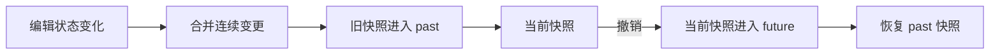
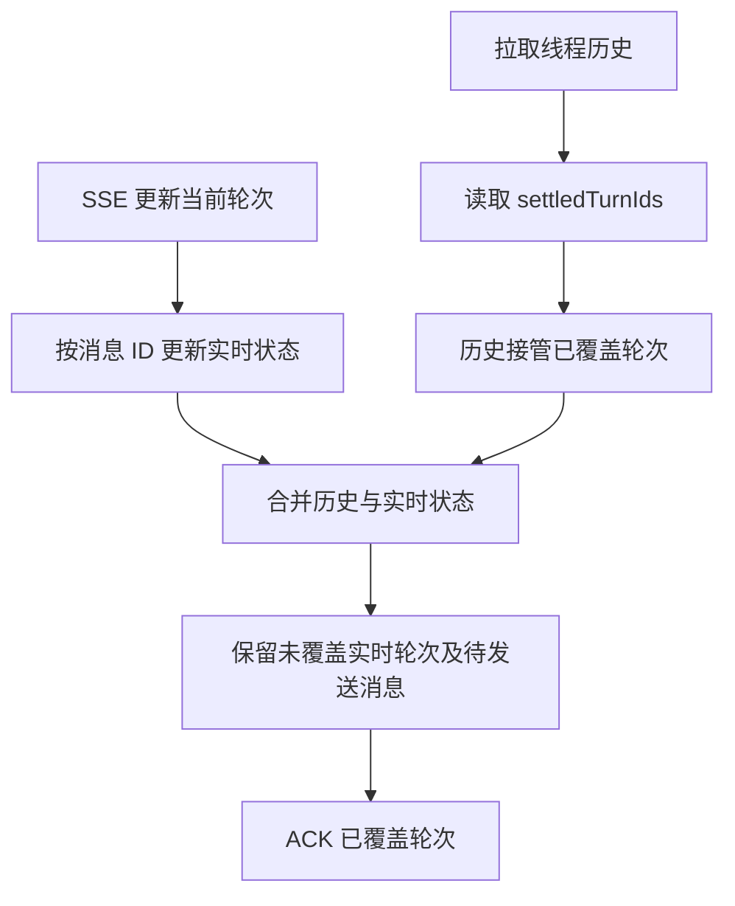
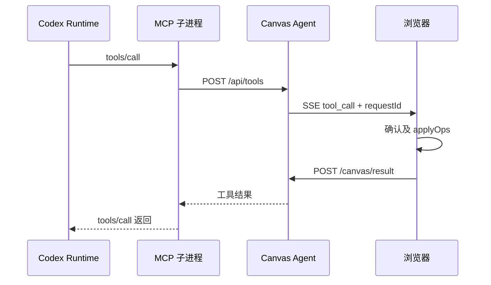

# Infinite Canvas 前端面试难点

本文按当前代码整理，重点展开三组：画布坐标与性能、撤销与异步一致性、Agent 实时消息与历史同步。Agent 专题进一步展开工具执行闭环、多标签页路由、会话状态与审批、进程通信，以及附件和 Skill 的归属与持久化。最后补充多模态输入、本地媒体管理与插件系统。

面试中的第一人称话术仅供参考，需按自己的实际贡献调整。本文没有性能压测数据，不应把“已有优化机制”描述为“已验证支持万级节点或稳定 60 FPS”。

## 一、项目开场：先让面试官理解复杂度

> 这是一个基于 React、TypeScript 和 Zustand 的无限画布应用，支持文本、图片、视频等节点，用户可以通过连线组织生成上下文，也能让本地 Agent 读取和修改画布。前端既要处理编辑器的高频交互，也要处理生成任务和 Agent 事件的异步回写。我重点介绍三个问题：坐标与性能、撤销与异步任务的一致性，以及流式消息和历史快照的同步。

渲染结构采用 DOM 节点、SVG 连线和 CSS 变换。这里的“画布”是业务概念，并非所有内容都绘制在 HTML Canvas 上。

## 二、难点一：画布坐标与高频渲染性能

### 1. 具体场景

用户缩放画布后，拖动一组节点，连线要同步移动；鼠标指向某个位置缩放时，这个位置应留在鼠标下方；输入框、弹层和画布又要各自响应正确的事件。

这个问题包含三个层面：

- 几何正确：节点位置、鼠标位置、框选范围和连线端点使用一致的坐标体系。
- 交互正确：区分点击、拖动、文本选择、框选和临时平移。
- 更新成本合理：高频事件不能带来同等频率的全量渲染、网络上报和存储写入。

### 2. 坐标转换

视口用 `{ x, y, k }` 表示：`x/y` 是平移量，`k` 是缩放比例。设鼠标相对容器的屏幕坐标为 `s`，画布世界坐标为 `w`，则每个轴满足：

```text
屏幕坐标 s = 世界坐标 w × k + 平移量 t
世界坐标 w = (屏幕坐标 s - 平移量 t) / k
```

浏览器的 `clientX/clientY` 还要先减去容器 `getBoundingClientRect()` 的 `left/top`。

拖动节点时：

```text
世界坐标位移 = 鼠标屏幕位移 / k
节点最终位置 = 拖动开始时的位置 + 世界坐标位移
```

例如缩放比例为 2 时，鼠标移动 100 像素，节点世界坐标只移动 50。按“起始位置 + 总位移”计算，可以避免在前一帧位置上不断累加产生偏差。

围绕鼠标缩放时，先求缩放前鼠标对应的世界坐标，再反推新平移量：

```text
w = (s - t) / k
t_new = s - w × k_new
```

这样改变缩放比例后，同一个世界坐标仍映射到同一个鼠标位置。

### 3. 交互冲突如何处理

当前代码通过事件边界和拖动状态协调交互：

- 输入框与 `contentEditable` 中的空格用于输入，不能触发画布临时平移。
- 弹层和带 `data-canvas-no-zoom` 的区域保留自己的滚动行为。
- 平移与框选入口使用 Pointer Capture；节点拖动通过全局监听处理移出节点后的移动与结束。
- 节点捕获阶段负责选中，后续拖动入口复用选中结果，避免 Shift 多选被执行两次。
- 使用移动阈值区分点击与拖动，并在 `pointercancel`、窗口失焦时结束拖动状态。
- 图片缩放按原始比例计算尺寸，并在拖动左侧或上侧手柄时保持对侧锚点。

不要简单说“所有事件都 stopPropagation”。关键是明确哪一层处理选中、哪一层处理拖动、哪些内层控件保留原生交互。

### 4. 性能处理及其作用

| 现有机制 | 解决的问题 | 实际边界 |
| --- | --- | --- |
| `requestAnimationFrame` 合并拖拽更新 | 鼠标事件可能比屏幕刷新更频繁，减少重复状态更新和分组命中检测 | 不保证每帧工作都能在预算内完成 |
| 视口裁剪节点和连线 | 只挂载可见区域及缓冲区内的节点，减少 DOM 和媒体组件数量 | 筛选仍遍历节点，尚不是空间索引 |
| `Map` 保存拖动起始位置、建立节点索引 | 避免每个节点再用 `find` 查起始位置或连线端点 | 拖动帧中仍有数组遍历，不能说整帧是 O(1) |
| `React.memo`、稳定回调和空引用数组 | 保留未修改节点的对象引用，让无关节点有机会跳过渲染 | 缩放等公共 props 改变时仍可能重渲染 |
| `ref` 保存最新状态 | 全局事件回调能读取最新节点和视口，降低闭包过期问题 | 需同步维护 ref 与 React 状态 |
| 拖动期间暂停历史及项目同步 | 避免中间帧进入历史与持久化流程 | 结束时仍需提交最终坐标 |
| 视口保存及 IndexedDB 写入防抖 | 降低高频序列化和写入成本 | 防抖存在未写入窗口，并非每次更新立即落盘 |
| Agent 面板不在渲染中订阅 `canvasContext` | 防止画布每帧更新带动整个聊天面板重渲染 | 通过命令式订阅保持 ref 最新，并防抖上报快照 |

连线裁剪还需要考虑贝塞尔曲线的控制点范围，不能仅因两端节点都不在屏幕内就认为整条曲线不可见。

### 5. 面试口述：约一分钟

> 画布的难点是把坐标正确性和高频更新成本一起处理好。我统一用世界坐标保存节点，视口只记录平移和缩放；所有鼠标输入先转换到世界坐标，缩放时反推平移量，保证鼠标锚点不变。
>
> 性能上，拖动按 requestAnimationFrame 合并更新，用 Map 查询节点起始位置，并裁剪视口之外的节点和连线。未变更节点保留对象引用，配合 memo 减少重渲染。拖动中只更新交互状态，结束后再进入历史和持久化流程。另外 Agent 面板通过命令式订阅读取画布上下文，避免画布拖动带动整个聊天界面每帧更新。

### 6. 面试追问

**为什么选择 DOM + SVG，而不是全部用 Canvas？**

节点包含输入框、媒体和插件组件，DOM 可以直接复用 React 和浏览器原生交互；SVG 适合连线。代价是节点规模扩大后，DOM 数量和 React 更新成本需要控制，所以做视口裁剪。不要声称 DOM 在任何规模下都更快。

**为什么有 memo 还可能卡？**

memo 只判断 props 是否变化；新数组、新函数、全局状态订阅、公共缩放参数都可能使它失效。另外节点筛选、连线计算、图片解码和浏览器绘制也可能成为瓶颈。

**如何证明优化有效？**

需要在相同节点规模和素材条件下，用 React Profiler 比较 commit 时间与节点重渲染数量，用 Performance 面板观察长任务和帧耗时，再统计存储写入及网络上报次数。当前文档没有这类实测结果，面试时可以介绍验证方法，不应编造收益百分比。

**节点进一步增多怎么做？**

先测量瓶颈。如果全量筛选成为主要成本，再考虑空间索引；如果媒体成本占主导，再考虑缩略图、延迟加载或简化远景内容。这些属于后续方向，当前不应描述为已实现。

### 7. 代码入口

- [视口变换、缩放锚点与平移](../web/src/components/canvas/infinite-canvas.tsx)
- [拖动、视口裁剪与节点索引](../web/src/pages/canvas/project.tsx)：`handleGlobalMouseMove`、`finishNodeDrag`、`visibleNodes`、`visibleConnections`。
- [节点 memo 与比例缩放](../web/src/components/canvas/canvas-node.tsx)
- [连线绘制与命中区域](../web/src/components/canvas/canvas-connections.tsx)
- [Agent 面板订阅与快照上报](../web/src/components/agent/local-agent-panel.tsx)

## 三、难点二：撤销重做与异步任务一致性

### 1. 具体场景

用户拖动一组节点，应该一次撤销整个拖动；删除节点需要同时处理连线和分组关系；生图或媒体恢复还在执行时，用户可能撤销、删除或重新生成。

因此，需要区分三件事：

- 画布状态回滚：恢复节点、连线等编辑数据。
- 本地异步任务取消：停止请求、下载或轮询。
- 外部任务状态：远端生成是否仍在运行、是否已经产生费用。

三者不等价。恢复一个快照不会自动取消 Promise，浏览器中止请求也不保证远端停止生成。

### 2. 当前撤销方案

普通画布历史采用快照栈：



快照覆盖节点、连线、画布内助手会话、当前会话、背景模式和图片信息展示。视口单独保存，不属于这套普通历史快照。

当前实现的关键点：

- `past/future` 保存撤销和重做历史；新编辑提交后清空 `future`。
- 连续变更使用 180ms 防抖合并，历史最多保留 50 条。这是现有值，本文没有调整它们。
- 拖动开始暂停历史，拖动结束恢复并提交最终位置，避免一段拖动产生几十条历史。
- 应用历史时用 `applyingHistoryRef` 暂停记录，防止“撤销本身”又成为新历史。
- 快照保存不可变状态引用，没有在每次操作时深拷贝整份画布。前提是后续更新不能原地修改旧对象。
- 恢复历史时清理选中态和菜单，避免 UI 继续指向不存在的节点。

需要注意：这套方案通过时间窗口合并变更，并不是完整的命令事务系统；相近时间发生的独立编辑或异步回写，仍可能进入同一条历史。

### 3. 异步任务如何管理

生成请求通过 `Map<targetNodeId, request>` 管理，记录目标节点、来源节点、运行标识及 `AbortController`：

- 同一目标开启新请求时，中止之前的 controller。
- 停止一个运行任务时，按运行标识取消相关请求，更新节点和批量结果槽位的状态。
- 请求结束时比较 controller 身份，只有当前请求才能移除注册项，避免旧请求的 `finally` 清掉新请求。
- 图片请求和下载链路传递 `AbortSignal`；取消异常走专门处理。
- 结果使用函数式 `setNodes(prev => ...)` 按 ID 更新当前节点，不直接用请求开始时的整个数组覆盖最新状态。

这里的身份比较保护的是请求注册表。它不能直接证明所有媒体结果写回都已经做了任务版本校验。

### 4. 两个真实的一致性细节

**媒体恢复期间发生撤销**

打开画布时，媒体 URL 异步恢复。恢复完成后，代码重新读取最新项目，按当前仍存在的节点 ID 过滤恢复结果，再使用最新连线。

这样可以处理“发送到画布后马上撤销，但打开页面的媒体恢复还没完成”的场景，避免恢复流程把已经移除的节点重新带回来。它解决的是节点存在性问题，并不等于对所有并发编辑都做了版本合并。

**历史仍引用媒体**

删除当前节点不意味着图片马上不再使用：撤销历史、重做历史或素材列表可能仍引用它。当前资源清理会把历史和最近快照纳入引用检查，否则撤销虽然恢复了节点数据，图片却可能已经被清掉。

### 5. Agent 撤销与普通画布历史的区别

`use-agent-bridge.ts` 在执行一批 Agent 操作前保存 `agentUndoSnapshot`，提供 `applyOps` 和 `undoOps`。

它是最近一次 Agent 操作前的整幅画布快照，不能描述为“任意多步 Agent 命令历史”或“只撤销 Agent 修改、保留之后所有手动编辑”。恢复整份旧快照可能覆盖后续编辑，也不会自动取消已经启动的生成任务。

### 6. 必须如实讲清的边界

普通 `applyHistory` 和 `deleteNodes` 当前没有统一调用生成取消逻辑。因此不能说“所有撤销和删除都会取消生成任务”。

按 ID 更新使已经不存在的节点不会被该次 `map` 写回凭空重建，但如果撤销后又重做，节点 ID 恢复，旧任务仍可能找到该节点。要完整解决，需要在写回前校验项目、节点和任务身份，或者明确撤销时相关任务的取消规则。

后续可考虑：

- 为结果写回增加任务版本校验，并在每个异步阶段后确认任务仍有效。
- 明确删除、撤销、重做与远端生成任务之间的产品语义。
- 对需要保留后续编辑的撤销，记录具体操作的反向变更，而非恢复整份快照。

这些是改进方向，本次仅整理文档，没有实现。

### 7. 面试口述：约一分钟

> 撤销的难点是定义一次操作的边界，并处理它与异步任务的关系。当前画布采用不可变快照和 past/future 栈，连续编辑做合并，拖动期间暂停记录，结束后再提交一次历史；应用历史时暂停监听，避免撤销又生成历史。
>
> 异步生成单独用 AbortController 和按目标节点管理的请求表处理，旧请求结束时要校验身份，避免清掉新请求。媒体恢复也会重新读取最新项目，过滤已经撤销的节点；资源清理会保留历史引用的图片。
>
> 当前还有明确边界：普通撤销没有统一取消生成任务。我会把状态回滚和任务取消分开设计，进一步通过任务版本校验防止旧结果写入恢复后的节点。

### 8. 面试追问

**为什么用快照，不用命令模式？**

节点、连线、分组和会话状态联动较多，快照容易覆盖完整状态，当前实现简单直接。命令模式更适合严格定义操作边界、减少历史体积或实现局部撤销，但需要维护每种操作及其反向操作。

**快照的成本是什么？**

历史会保留旧对象和媒体引用；不可变更新减少不必要复制，但不是零成本。另外整份快照恢复可能覆盖后续修改，因此不适用于所有“只撤销某个人的一次操作”的需求。

**如何处理旧请求覆盖新结果？**

取消旧请求只是第一层。更完整的方案需要在写回时比较请求标识或版本，而且检查应覆盖请求、媒体下载、持久化和最终状态写入这些异步阶段。当前已有 controller 身份检查用于请求表清理，不应扩大为全链路已保证。

**怎么验证？**

可以构造慢请求，在请求中途停止、删除、撤销和重做；验证连线与节点一起恢复、旧请求不清理新注册项、媒体恢复不复活已移除节点，以及历史图片在清理后仍可恢复。这是建议的验收场景，不是本次已执行的测试。

### 9. 代码入口

- [画布历史与生成管理](../web/src/pages/canvas/project.tsx)：`createHistoryEntry`、`applyHistory`、`undoCanvas`、`redoCanvas`、`startGenerationRequest`、`finishGenerationRequest`、`stopGenerationByRunningId`。
- [Agent 操作快照](../web/src/pages/canvas/hooks/use-agent-bridge.ts)
- [画布持久化](../web/src/stores/canvas/use-canvas-store.ts)

## 四、难点三：Agent 实时事件与历史快照同步

### 1. 具体场景

用户发送问题，界面先显示本地待发送消息，再接收 SSE 流式回复。任务完成或重新连接后，前端又拉取历史快照。服务端还可能重放连接中断前的事件。

同一条消息可能先后出现在多个入口：

```text
本地待发送消息
SSE chat_message
SSE agent_event 的增量与完成事件
线程历史快照
断线重放事件
```

直接把这些数据追加到列表会导致重复；只覆盖整个列表会丢失尚未进入历史的流式内容；只按文本去重又会把两次相同提问误认为同一条消息。

### 2. 消息身份与归属

消息按以下组合识别：

```text
threadId：属于哪个会话
turnId：属于哪一轮交互
itemId：属于这一轮中的哪个消息或工具项
```

前端 `scopeChatItem` 构造包含这三层的消息 ID，再以该 ID 做 upsert。用户消息使用每轮固定的 `synthetic:user` 项，同时用 `clientMessageId` 关联发送时的本地消息与服务端确认。

所以，相同文本可以出现在不同轮次；一个轮次也可以同时包含推理、工具和多个消息项。

文本前缀或重叠处理仅用于已确定身份的同一条流式消息内部，不是跨消息去重依据。

### 3. 历史与实时消息的权威切换

核心规则是：已完成且被历史覆盖的轮次以历史为准；未被覆盖的实时轮次继续保留。



`loadThreadSnapshot` 的处理包括：

1. 读取历史消息并规范化消息身份，清理历史上的流式标记。
2. 根据 `settledTurnIds` 建立已覆盖轮次集合。
3. 从实时轮次集合移除已被历史接管的轮次。
4. 以历史列表为基底合并：已覆盖消息采用历史正文，实时轮次采用当前流式状态，并保留必要附件、素材引用和 Skill 元数据。
5. 对已覆盖轮次发送 ACK。

`turn.completed` 到达并不代表权威历史立即可读。前端会暂时保留这个轮次的实时内容，按现有重试策略等待历史覆盖，避免任务结束的一瞬间消息消失。

### 4. 防止会话切换和事件处理竞态

用户可能从会话 A 切到 B，而 A 的历史请求稍后才返回。

当前用请求序号与最新 `activeThreadId` 双重检查，只允许当前请求更新当前会话。同时对 SSE 消息检查会话归属，旧连接通过 disposed/clientId 检查失效。

相关消息事件通过 Promise 队列串行处理，减少异步事件处理互相穿插造成的状态错乱。这里不能说“所有 SSE 事件都经过同一个队列”：工具调用等入口有独立处理流程。

### 5. 重放、ACK 与副作用

连接恢复后，服务端会重放缓存的消息和活动事件，并标记 `replayed`。

- 已被权威历史覆盖的重放轮次直接跳过，避免重新追加或合并。
- 未覆盖轮次的重放事件用于恢复 UI 状态。
- 图片生成完成后的导入动作只对非重放事件、且来源客户端匹配时执行，避免重连重复创建图片节点。
- 重放日志和错误事件抑制重复提示，区分“恢复展示”和“再执行一次业务动作”。

前端调用 `/agent/codex/history/ack` 后，服务端清理匹配 `threadId/turnId` 的内存重放缓存。ACK 不删除 Codex 的持久化聊天历史。

ACK 主要用于回收缓存；正确性仍依赖前端的权威轮次检查和消息身份合并，不能把 ACK 本身当成去重算法。

### 6. Agent 操作画布的闭环

这一组还能顺带展示前端与 Agent 的系统协作能力：

```text
Codex 发起 MCP 工具调用
  → Canvas Agent 派发 SSE tool_call
  → 浏览器按配置处理写操作确认
  → canvasContext.applyOps 更新画布
  → 携带 requestId 回传 /canvas/result
  → MCP 调用获得结果，Codex 继续执行
```

`AgentCanvasContext` 包含快照及 `applyOps/undoOps`，是画布与 Agent 的桥接入口。浏览器负责执行页面业务状态变更，本地 Agent 负责协议和工具调度。

工具结果依靠 `requestId` 匹配等待中的调用；标签页使用 `clientId`，服务端管理目标页面。`sessionStorage` 保存客户端标识，Web Locks 可用于发现复制标签页造成的标识冲突。

写操作确认依赖配置，不能说所有工具都必须人工确认；多标签页路由与会话消息归属也属于两个不同层面的隔离。

### 7. 面试口述：约一分钟

> Agent 消息既来自 SSE，也来自线程历史，断线后还会重放。这里最重要的是消息身份和数据权威：我按 threadId、turnId、itemId 确定归属，避免按文本去重；用 settledTurnIds 判断哪些轮次已进入权威历史。
>
> 合并时，历史接管已覆盖轮次，未覆盖轮次保留实时内容。历史请求再用序号和当前会话检查，防止切换会话后旧响应覆盖新界面。重放可以恢复展示，但图片导入等副作用不能重复执行。历史接管后再 ACK 服务端回收内存缓存。
>
> 另外浏览器通过 applyOps 执行 Agent 的画布工具，并按 requestId 回传结果，形成模型调用到页面执行再到模型继续推理的闭环。

### 8. 面试追问

**为什么用 SSE？**

服务端需要持续推送消息和状态，浏览器到服务端的提交、审批和工具结果通过 HTTP 即可。SSE 提供流式推送和浏览器自动重连，但业务上的缺失恢复、消息去重和副作用控制仍需要自己处理。

**为什么只用 itemId 不够？**

它无法充分表达项目约定的会话和轮次归属，尤其存在每轮重复使用的合成项。完整身份能防止跨会话、跨轮次误合并。

**如何做到 exactly-once？**

不能把当前机制描述为严格 exactly-once。消息展示通过身份 upsert、历史覆盖和重放过滤收敛；副作用有重放拦截。若业务需要严格一次执行，还需持久化幂等键、执行状态及结果，明确执行成功但结果回传失败时如何恢复。

**为什么结束后还要拉历史？**

流式事件是即时展示来源，历史用于校准完整正文和最终状态；连接中断可能漏事件，持久化又可能稍晚于完成通知，因此需要一次权威收敛。

**如何验证？**

重复发送相同问题、在流式中断网重连、在历史请求未返回时切换会话、让完成事件早于历史落盘、重放图片生成事件，再检查消息数、归属、正文和节点数。这些是面试可介绍的验证思路，本次没有运行验收。

### 9. 代码入口

- [Agent 状态与桥接类型](../web/src/stores/use-agent-store.ts)
- [SSE、历史加载与工具执行](../web/src/components/agent/local-agent-panel.tsx)：`loadThreadSnapshot`、`enqueueEvent`、`handleAgentEvent`、`runToolCall`。
- [消息身份与历史合并](../web/src/components/agent/agent-event-formatters.ts)：`scopeChatItem`、`mergeAgentMessages`、`registerLiveAgentTurn`。
- [HTTP 与历史 ACK](../web/src/services/api/canvas-agent.ts)
- [服务端重放与 ACK 清理](../canvas-agent/src/canvas/session.ts)

## 五、Agent 专题：从聊天到业务执行

第四节已经展开消息一致性，这里补充 Agent 执行层的难点。面试时根据岗位侧重点选择两到三项展开，不必逐项背诵。

### 1. 跨协议工具执行闭环

**场景与难点**

用户说“把这两张图放到画布右侧并连起来”，模型输出工具调用后，必须由实际持有 React 业务状态的浏览器执行，并把执行结果送回模型。普通聊天接口返回文本就结束了，Agent 则需要在工具结果返回后继续推理。

当前链路是：



实现要点：

- MCP Server 用 SDK 注册工具，工具输入通过 Zod schema 校验；本地 HTTP 分发层再次校验工具名称和输入。
- 读取画布的部分工具直接返回服务端缓存的浏览器快照；需要网页执行的工具才进入 SSE 往返链路。
- 服务端为网页工具分配 `requestId`，用 pending Map 保存 Promise 的 resolve/reject 和目标 `clientId`。
- 浏览器经 `AgentCanvasContext.applyOps` 执行结构化操作，再携带 `requestId` 回传成功结果或错误。
- 服务端同时匹配 `requestId` 与 `clientId`，只允许对应页面完成该次等待。
- 当前网页工具等待超时为 30 秒，超时移除 pending 并返回“画布操作超时”；页面断开时拒绝该页面的等待。这里记录现有行为，没有新增或调整边界值。

**取舍与边界**

浏览器上报快照有防抖，服务端缓存可能稍落后于当前 UI；它不是每次读取都即时查询 DOM。

`applyOps` 返回表示操作已应用到业务状态、生成动作已被调度，不保证图片或视频生成已完成，也不保证浏览器绘制或 IndexedDB 落盘已经结束。

如果页面执行成功但结果回传失败，当前不能宣称具备自动恢复的严格一次执行保证。生产级重试需额外维护持久化幂等记录与可查询的执行结果。

**面试口述**

> Agent 工具的难点是跨进程、跨协议完成一次真实业务操作。我让 MCP 调用通过本地 HTTP 转成浏览器 SSE 请求，浏览器统一执行结构化操作，再按 requestId 回传结果；服务端还校验 clientId，避免其他页面误完成调用。整个等待过程有成功、错误、页面断开和超时出口，让模型能继续执行，而不是只看到一句“操作成功”的文本。

**常见追问：为什么模型不直接修改 Zustand？**

Zustand 状态位于浏览器进程，模型运行时在本地服务之外。统一工具入口能复用页面业务规则、确认和反馈，避免把页面操作散落为模型生成的任意 DOM 脚本。

代码入口：[MCP 服务](../canvas-agent/src/server/mcp.ts)、[工具 schema](../canvas-agent/src/canvas/schemas.ts)、[服务端调用等待](../canvas-agent/src/canvas/session.ts)、[浏览器执行](../web/src/components/agent/local-agent-panel.tsx)、[画布桥接](../web/src/pages/canvas/hooks/use-agent-bridge.ts)。

### 2. 多标签页隔离：焦点变化不能改变运行任务的目标

**场景与难点**

用户同时打开画布 A、B，在 A 发起任务后切到 B。工具调用不能因为 B 获得焦点就修改 B；复制标签页还可能复制 `sessionStorage` 中的客户端标识。

当前实现：

- 每个页面用 `clientId` 连接 SSE、上报自己的画布快照；服务端按客户端保存快照。
- 页面使用 `sessionStorage` 保留刷新后的标识，Web Locks 尝试独占对应标识；发现占用就生成新 ID。
- `activeClientId` 表示当前激活页面；Turn 启动时绑定发起页面为 `boundClientId`。
- 工具目标优先取 `boundClientId`，没有绑定时才使用 `activeClientId`，因此运行中切换焦点不会改变工具目标。
- 图片附件也检查发起客户端归属；生成图片自动导入还校验 `sourceClientId`。
- 原页面断开时拒绝它的 pending 工具，不能静默把这些请求交给另一个标签页执行。

**取舍与边界**

Web Locks 不可用时，代码回退到保存的标识，不保证复制标签页场景仍具备相同的冲突检测能力。绑定的是客户端标识，不能扩大为“所有异步操作都绑定了不可变的画布项目版本”。

多标签页隔离不代表多个 Codex Turn 可并行运行；当前 Codex 任务队列与会话修改入口仍有串行和忙碌约束。

**面试口述**

> 我把当前激活页面和任务绑定页面分开管理。新任务从发起页面绑定 clientId，后续工具始终优先路由到它；焦点切换只影响下一次目标选择。复制标签页的 ID 冲突通过 Web Locks 检测，工具回传也校验客户端身份。页面断开后让原请求失败，而不是让另一个画布代执行。

**常见追问：为什么 sessionStorage 本身不够？**

它适合在标签页会话中保存标识，但复制标签页可能继承其初始值。需要额外检测标识是否已被其他页面占用。

代码入口：[客户端标识获取](../web/src/components/agent/local-agent-panel.tsx)：`acquireAgentClientId`；[服务端客户端路由](../canvas-agent/src/canvas/session.ts)：`bindClient`、`activateClient`、`resolveResult`。

### 3. 会话状态、审批与中断：不能只用一个 loading

**场景与难点**

HTTP/SSE 已连接，但 Codex 线程或 MCP 可能还没初始化；部分 MCP 失败时，其余工具可能仍可用；用户切换会话后，旧页面状态还可能发起请求。模型还会提出命令、文件或权限审批。

当前使用明确的会话状态：

```text
idle / preparing / ready / warning / running / failed
```

这些状态不能与 `connected` 混为一谈：连上 Canvas Agent 不代表运行时和工具都已就绪。

实现要点：

- 服务端会话快照带 `conversationId` 与递增 `revision`；前端常规更新只接受更高 revision，重连等场景可强制应用快照。
- 发送 Turn 时前端携带会话、线程和预期 revision；服务端检查是否仍对应当前状态。旧请求返回 409 `CONVERSATION_STALE` 并附最新状态。
- 对话未就绪时拒绝发送，忙碌时限制会话修改；各 MCP 服务的启动状态分别展示。
- 画布写操作确认由 `confirmTools` 控制；它与 Codex 的命令、文件、权限审批是两套机制。
- Codex 审批通过 `requestId` 找到原始 JSON-RPC 请求，按方法构造审批响应；已提交决定避免重复响应，失效请求返回明确错误。
- 停止操作调用 `turn/interrupt`，按运行中的线程和轮次中断；不只是清空前端 waiting 状态。

**取舍与边界**

revision 保护会话状态，不能代替画布节点的任务版本或数据冲突校验。中断 Turn 也不等于回滚已执行的画布操作、文件写入或远端生成任务。

**面试口述**

> 我把连接状态、会话准备、工具启动、运行和待审批分开表达。发送请求时带会话 ID 和 revision，让服务端拒绝旧状态下的操作。审批保留原请求身份，确认后回复对应运行时请求；停止则调用真正的 Turn 中断接口。这样前端展示、服务端状态和运行时动作可以对应起来，而不是只靠一个 loading 控制按钮。

**常见追问：warning 为什么还允许发送？**

它表示部分 MCP 服务不可用，其余能力仍可工作。界面需要明确展示失败服务，不能把“部分可用”表现为所有工具正常。

代码入口：[会话状态及客户端管理](../canvas-agent/src/canvas/session.ts)、[请求前置检查及审批接口](../canvas-agent/src/server/http.ts)、[前端状态应用](../web/src/components/agent/local-agent-panel.tsx)、[Codex 审批与中断](../canvas-agent/src/agent/codex-client.ts)。

### 4. 运行时进程通信与失败收敛

**场景与难点**

Canvas Agent 通过 stdio 与 Codex app-server 通信。一次 stdout 数据回调可能只有半条 JSON，也可能包含多条；响应、事件和运行时反向发起的审批请求还可能交错到达。

当前处理：

- 启动后完成 `initialize/initialized` 握手，再使用线程、Turn 和 MCP 接口。
- stdout 按协议行分帧，保留未完成的尾部缓冲，不把一个 data chunk 当成一条消息。
- JSON-RPC 请求按数字 ID 放入 pending Map；响应按 ID 完成对应 Promise。
- 通知进入事件处理，审批等反向请求按原请求 ID 回复，不能把所有带 ID 的消息都当成普通响应。
- 增量内容先按消息身份聚合，再推送统一事件，减少大量碎片更新；完成事件前需要刷新相关待发送增量。
- 子进程失败时拒绝挂起请求和运行中的 Turn，清理相关计时器及审批状态，避免界面永久停在运行中。
- Codex Turn 使用串行 Promise 队列，且前一次失败不会让后续队列永久失效。

**取舍与边界**

这套 stdio 按行解析依赖当前运行时的协议约定，不应泛化为所有 JSON-RPC 传输方式。运行时事件归一化也不能证明 Codex 与 Claude 适配器能力完全对等；Claude SDK 替换仍在项目待办中。

**面试口述**

> 运行时通信的难点是消息分帧、双向请求和进程异常。我按行缓冲解析 stdout，按请求 ID 匹配响应，并区分通知与运行时审批请求。退出时统一拒绝挂起任务，让上层能恢复失败状态；流式增量按消息身份聚合，并在完成前刷新，避免最终状态到达后文本还缺一段。

代码入口：[Codex 协议客户端](../canvas-agent/src/agent/codex-client.ts)、[协议类型](../canvas-agent/src/agent/codex-protocol.ts)、[任务队列](../canvas-agent/src/agent/codex.ts)。

### 5. 附件、素材引用与 Skill：展示内容必须有准确归属

**场景与难点**

用户输入普通文本、图片附件、`@` 画布引用和 `/` Skill。发送后页面刷新，本地临时 URL 失效，而模型历史通常不包含前端展示需要的全部引用和 Skill 元数据。

实现要点：

- 前端把文本和不可编辑 token 序列化，Skill 同时携带 name/path；服务端从原生 Skill 列表检查名字、路径和启用状态，不能直接信任浏览器给出的文件路径。
- 图片在本地运行时链路中转为临时文件，通过 `localImage` 传入 Codex；展示预览与模型输入文件不是同一份生命周期。
- 展示元数据先按 `clientMessageId` 保存 pending 记录，再随着运行时确认绑定 `threadId/turnId`。
- 历史恢复按精确轮次关联用户消息，补回附件、画布引用和 Skill，不靠提示词文本相似度猜匹配。
- 预览写入本地持久化文件，避免依赖刷新前的 Blob URL；写文件通过临时文件和 rename 替换。
- 消息存储版本与通信协议版本独立；未知版本或损坏存储拒绝覆盖，不能因通信协议更新清空聊天展示数据。

**取舍与边界**

图片输入不能扩大为音视频已自动转写或抽帧。持久化展示元数据也不等于完整存档当时的整个画布；相应历史删除使用逻辑归档，不能承诺物理删除全部 Codex 原始会话文件。

**面试口述**

> 多模态聊天需要把输入、展示和历史归属分开。图片给模型的是本地文件，界面预览要单独持久化；素材引用和 Skill 元数据先跟 clientMessageId 关联，拿到运行时身份后再绑定会话和轮次。刷新时按精确 ID 恢复，而不是按文本匹配。另外 Skill 的路径和启用状态由服务端原生列表校验。

代码入口：[输入 token 编辑器](../web/src/components/agent/agent-chat-prompt-input.tsx)、[输入与 Skill 解析](../canvas-agent/src/agent/codex.ts)、[消息元数据存储](../canvas-agent/src/agent/message-metadata.ts)。

### 6. 面试中如何区分这些 ID

| 标识 | 解决的问题 | 不能替代的能力 |
| --- | --- | --- |
| `requestId` | 匹配一次网页工具调用或审批 | 不代表执行已持久化、可安全重试 |
| `clientId` | 工具及附件属于哪个页面 | 不代表具体项目的不可变版本 |
| `threadId + turnId + itemId` | 消息身份、更新与历史归属 | 不控制工具路由 |
| `clientMessageId` | 关联本地发送消息与后续运行时确认 | 不靠正文去重 |
| `conversationId + revision` | 拒绝旧会话状态下的操作 | 不解决节点数据的并发冲突 |

建议验收场景：A 页面发起任务后切到 B、复制标签页、执行中关闭目标页面、重复提交审批、会话切换期间发送旧请求、子进程退出、生成图片事件重放、带引用与 Skill 的消息刷新恢复。本次只补充分析，没有执行这些验收。

## 六、其他可补充难点

| 难点 | 面试切入点 | 代码入口 |
| --- | --- | --- |
| 多模态生成上下文 | 把连线、分组和提示词中的引用转换成模型请求；按节点去重，保持素材编号与提示词一致，并恢复本地媒体 | `canvas-node-generation.ts` |
| 本地媒体与 WebDAV 同步 | 元数据与 Blob 分开管理；恢复临时 URL；合并远端记录、保留删除标记，协调媒体上传与清单写入 | `image-storage.ts`、`app-sync.ts` |
| 动态插件 | 下载源码后通过 Blob URL 导入，复用宿主 React，缓存并恢复插件；禁用和升级时清理样式与节点注册 | `plugin-loader.ts`、`plugin-runtime.ts` |

这些可以在面试官继续追问时补充。主线优先围绕前三组展开，避免把回答变成功能清单。

## 七、两分钟综合表达

> 项目是一个带 AI 生成和本地 Agent 的无限画布，前端最难的是高频编辑与异步事件同时修改状态。
>
> 第一是画布坐标和性能。我统一使用世界坐标，鼠标输入通过视口变换转换，缩放时保持鼠标锚点。拖动按帧合并，配合节点和连线的视口裁剪、Map 查询和稳定引用减少开销；历史、存储和 Agent 快照上报分别控制频率。
>
> 第二是撤销和异步一致性。普通历史采用不可变快照，拖动结束形成一次编辑记录，恢复时暂停历史监听。生成任务用 AbortController 和请求表管理，媒体恢复会检查当前仍存在的节点，资源清理保留历史引用。这里需要如实说明：普通撤销还没有统一取消任务，完整防止旧结果写回需要进一步校验任务版本。
>
> 第三是 Agent 消息同步。我按会话、轮次和消息项确定身份，用历史覆盖已完成轮次，同时保留尚未物化的实时内容；通过请求序号避免切换会话竞态，通过重放标记避免重复图片导入，再用 ACK 回收服务端缓存。模型操作画布则通过工具协议交给浏览器执行，并回传结果。
>
> 这三组体现的是坐标模型、更新成本和异步状态收敛。具体性能收益需要实测，任务一致性也要按实际已覆盖的场景说明。

## 八、Agent 方向的一分钟表达

> Agent 部分最难的是把模型工具调用变成真实页面操作，并让消息、页面和运行时状态保持一致。我用 MCP、JSON-RPC、HTTP 和 SSE 打通执行链路，浏览器通过统一 applyOps 修改画布，再按 requestId 和 clientId 回传结果。
>
> 多标签页上，我区分激活页面与 Turn 绑定页面，避免焦点切换改变任务目标；会话操作使用 conversationId 和 revision 防止旧状态提交，审批与中断真正回到运行时。消息方面按会话、轮次和消息项归属，用历史接管已覆盖轮次，并阻止重放事件重复导入图片。
>
> 附件、引用和 Skill 的展示元数据独立保存，刷新后按精确身份恢复。实现的边界也很明确：当前不是严格一次执行系统，中断不会自动回滚业务副作用，完整重试与冲突处理仍需要额外设计。
